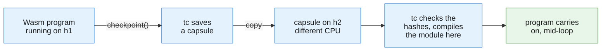

# vm-teleport-experiments

Pause a running program on one kind of CPU, and resume it on another.

This repository moves a counter, a Python interpreter and a network client between four virtual machines: an Intel x86-64 machine, an Arm machine, a RISC-V machine and an AMD x86-64 machine. It runs the usual tool for moving processes, CRIU, on the same moves, to show where that tool stops working. Every experiment is a `make` target, and its recorded output is in [results/](results/).

The idea in one sentence: **move the state, not the machine code, and let each CPU make its own machine code.**

A WebAssembly (Wasm: a portable program format that no real CPU runs directly) program has no machine code of its own. Each host compiles the same `.wasm` file for its own CPU. What moves is only the program's state: its memory, its globals and a few facts about its files and clock. The host runtime, `tc`, saves that state into a directory called a **capsule** and restores it on the next host.



The code never moves. Only the capsule does (blue = a step, green = the result).

## What it shows

| # | What moves | Result |
| --- | --- | --- |
| 1 | A counter, paused between calls | Survives h1 → h2 → h3 → h4, on four CPU models of three ISAs (instruction set architectures) |
| 2 | A loop, paused in the middle of a call | Survives. The call stack travels too, through Binaryen's Asyncify pass |
| 3 | A whole Python interpreter, paused mid-script | Survives. The interpreter does not restart |
| 4 | A native process, with CRIU | Fails across ISAs. Between two x86-64 CPUs it works only if the CPU has every instruction that the C library chose at start-up |
| 5 | A program with an open network connection | The connection does not move. A login session survives if the program held a token. A transaction tied to the connection is lost |
| 6 | The same client, with a floating IP | CRIU keeps the connection across hosts when the address moves with the process, the move is announced, and the network path carries it |

The write-up with the evidence for each row is [docs/results.md](docs/results.md).

## Requirements

An x86-64 Linux machine. The experiments boot QEMU virtual machines, so `/dev/kvm` should be usable (without it, set `H1_ACCEL=tcg H4_ACCEL=tcg H5_ACCEL=tcg`, and expect it to be much slower). Plan for about 9 GB of free memory (four VMs of 2 GB, and a 0.5 GB helper) and about 10 GB of disk space once everything is downloaded and built (9.6 GB in the verification run).

| You need | Used for |
| --- | --- |
| `qemu-system-x86_64`, `qemu-system-aarch64`, `qemu-system-riscv64`, `qemu-img` | The four VMs (and a fifth, h5, for the last experiment) |
| UEFI firmware for Arm and RISC-V (the `edk2` packages) | Booting those two VMs. See [Configuration](#configuration) if yours is in another place |
| `genisoimage`, `ssh`, `curl`, `git`, `rsync`, `openssl`, `tar`, `xz`, `make`, `python3` | Building the VM seeds, talking to the VMs, downloading |
| Rust 1.100.0 (`rust-toolchain.toml` makes rustup install it), with the targets `wasm32-wasip1`, `aarch64-unknown-linux-musl` and `riscv64gc-unknown-linux-gnu` | Building `tc` for each ISA, and the Wasm guests |
| `zig` | The cross C compiler for the Arm and RISC-V builds |

`make tools` downloads pinned copies of wasmtime, Binaryen, wasi-sdk and Wasmer into `tools/`, and `make images` downloads the Debian 13 cloud images. Run `make doctor` to check the machine before you start.

## Quick start

```sh
make doctor               # check this machine
make demo-step            # experiment 1: builds, downloads and boots everything it needs first
```

Every experiment target lists what it needs (the pinned tools, the Debian images, `tc` for each ISA, the guests, the VMs), and `make` builds or boots those first. Downloads and the CPython build leave a stamp, so they run once. You can still run the setup steps on their own: `make tools images host guests python up`.

`make help` lists every target. Nothing needs root on your machine: the VMs run as you, and CRIU runs as root inside them.

### How long it takes

From a clean checkout, on one machine with a fast connection (your times will differ):

| Step | Time |
| --- | --- |
| `make tools`, `make images` | 26 s, 41 s (downloads) |
| `make host`, `make python` | 157 s, 100 s |
| `make up` | 74 s |
| experiments 1 to 3 | 5 to 12 s each |
| experiment 4, `make criu` | 118 s (it reboots h4 three times) |
| experiments 5 and 6 | 85 s, 17 s, 25 s, 4 s and 55 s |
| `make mutate` | 79 s |

## The experiments, in order

Each target first runs what it needs (the `Needs` column), so any of them runs alone from a clean checkout. Run them in this order to follow the story. Each one writes its transcript to `results/`, replacing the recorded one, and prints a `RESULT` at the end.

| Order | Target | What it does | Runs first |
| --- | --- | --- | --- |
| 0 | `make hosts` | Shows each VM's architecture, CPU model and kernel | `up` |
| 1 | `make demo-step` | Counter paused between calls: h1 → h2 → h3 → h4 | `host guests up` |
| 2 | `make demo-async` | Loop paused in the middle of a call | `host guests up` |
| 3 | `make demo-py` | Python script paused in the middle of its run | `host python up` |
| 3b | `make crosscheck` | Checks the capsules and the output with tools other than `tc` | experiments 1 to 3 |
| 4 | `make criu` | Native process with CRIU. Reboots h4 through three CPU models | `host-native guests up` |
| 5a | `make demo-net` | Wasm program with an open network connection | `host guests up` |
| 5b | `make criu-net` | Native client with an open HTTPS connection, with CRIU's TCP options | `up` |
| 5c | `make criu-net-probe` | Looks inside the restored TCP socket of the case that fails | `up` |
| 6a | `make up-vip` | Reboots h1 and h4 with a private network link, and boots h5 | `images` |
| 6b | `make vip-check` | Checks that link | `up-vip` |
| 6c | `make criu-vip` | Keeps a connection across hosts with a floating IP, and two controls | `up-vip` |

`make run` is a shortcut that needs no VMs: it pauses and resumes both Wasm guests on your own machine.

The transcripts in `results/` are the output that these targets produced when the repository was last verified. Your hash values and timings will differ. Your outcomes should not.

## Reading the output

Every experiment prints in the same layout, so you can follow it from the `do` and `got` lines and skip the rest:

```text
EXPERIMENT  what is being done, in one line
QUESTION    what the run answers, as a question
HOW         how it works (some experiments only)

[2/4] the place, and what this step is
  do    what the step does
  got   what came out of it
  next  what happens after it
  prog  one line printed by the program under test
  raw   one line of the tool's own output, unchanged

RESULT  PASS, FAIL, DONE or FINDING
        one line for each fact behind it
```

`do` says what is about to happen, before the slow part runs. `got` says what happened, in plain words, written by the script from the tool's own output. If a line that a `got` needs is missing, the script stops and shows the full output. `RESULT` says PASS or FAIL only where a script checked something. An experiment that measures behaviour ends with FINDING or DONE, and one line for each case. The layout is defined in [scripts/lib/say.sh](scripts/lib/say.sh).

## Repository layout

```text
Makefile                  every target; `make help` lists them
crates/tc/                the host runtime: start, resume, precompile, inspect
guests/                   the programs that get moved
  step-counter/             a counter, paused between calls
  async-counter/            a loop, paused mid-call (Asyncify)
  py-counter/               CPython for WASI, and the Python script
  net-counter/              a Wasm client that talks to a server
  criu-counter/             the native counter and the CPU probe for CRIU
  wasmer-spike/             a short try of Wasmer's journaling
scripts/
  teleport.sh               move one guest across a list of hosts
  criu/                     experiment 4
  net/                      experiments 5 and 6: server, client, CRIU runs
  check/                    checkers that read the transcripts
  lib/say.sh                the output layout
  mutate.py                 delete each check in `tc`; a test must fail
  doctor.sh, hosts.sh       the environment check, and the VM summary
vms/                      QEMU launchers, image download, cloud-init seed
tools/                    pinned-tool download, and the zig wrappers
docs/                     design notes, capsule format, and the long write-up
results/                  the recorded output of each experiment
```

## Configuration

| Variable | Default | What it does |
| --- | --- | --- |
| `SSH_PORT_BASE` | `2220` | h1 to h5 listen on this port plus 1 to 5, on `127.0.0.1`. Change it if those ports are taken |
| `L2_PORT` | `45551` | The UDP port of the private link in experiment 6. Change it to run two copies side by side |
| `H1_ACCEL`, `H4_ACCEL`, `H5_ACCEL` | `kvm` | Set to `tcg` to emulate those VMs when `/dev/kvm` is not available |
| `ARM_FW_CODE`, `ARM_FW_VARS` | `/usr/share/edk2/aarch64/...` | The Arm UEFI firmware and its variable store |
| `RISCV_FW_CODE`, `RISCV_FW_VARS` | `/usr/share/edk2/riscv64/...` | The same for RISC-V |
| `QEMU_IMG` | `qemu-img` | The `qemu-img` to use |
| `PYTHON` | `python3` | The Python that runs the checkers |

## Development

```sh
make lint     # rustfmt and clippy (host and guests), ruff and pyright, shellcheck, markdownlint and Mermaid
make test     # the host's tests, and the checker's self-test (needs `make guests`)
make mutate   # delete each check in tc in turn; a test must fail each time
make fmt      # format the Rust and Python code
```

The linters run with strict settings: clippy with the pedantic group, ruff with every rule, pyright in strict mode. [.github/workflows/ci.yml](.github/workflows/ci.yml) runs them, and the tests, on every push. The experiments themselves need VMs, so CI does not run them.

## Cleaning up

`make clean` stops the VMs and removes everything that was generated: build output, the downloaded tools and images, the VM disks and shared directories, the test server's certificate, and the tool caches. After it, the working tree holds only source files. The recorded transcripts in `results/` are source, so they stay. Because it removes the images, the next `make up` downloads them again.

## What it does not cover

- **Real hardware.** The Arm and RISC-V hosts are emulated, and the "AMD" host is an AMD CPU model on whatever CPU you have.
- **Pausing at any moment.** A guest pauses only where it calls `ckpt.checkpoint()`.
- **Open files, threads and child processes.** A capsule carries none of them.
- **A real database or RPC service.** Experiment 5 uses a small purpose-written test server.
- **AVX-512.** The CRIU experiment uses AVX, because many CPUs lack AVX-512 and neither KVM nor TCG can supply it.

[docs/results.md](docs/results.md) has the full list, with the reasons.

## Further reading

- [docs/results.md](docs/results.md): each experiment explained, with its output
- [docs/design.md](docs/design.md): the setup, what each experiment is expected to show, and related projects
- [docs/capsule-format.md](docs/capsule-format.md): what is in a capsule, and what is not

## License

[MIT](LICENSE).
