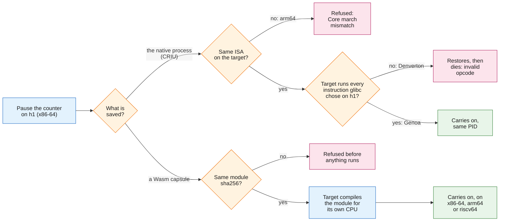
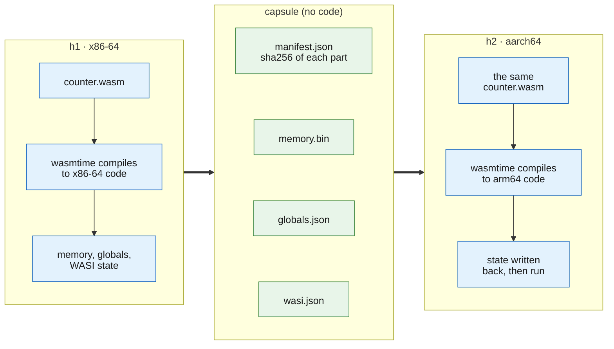
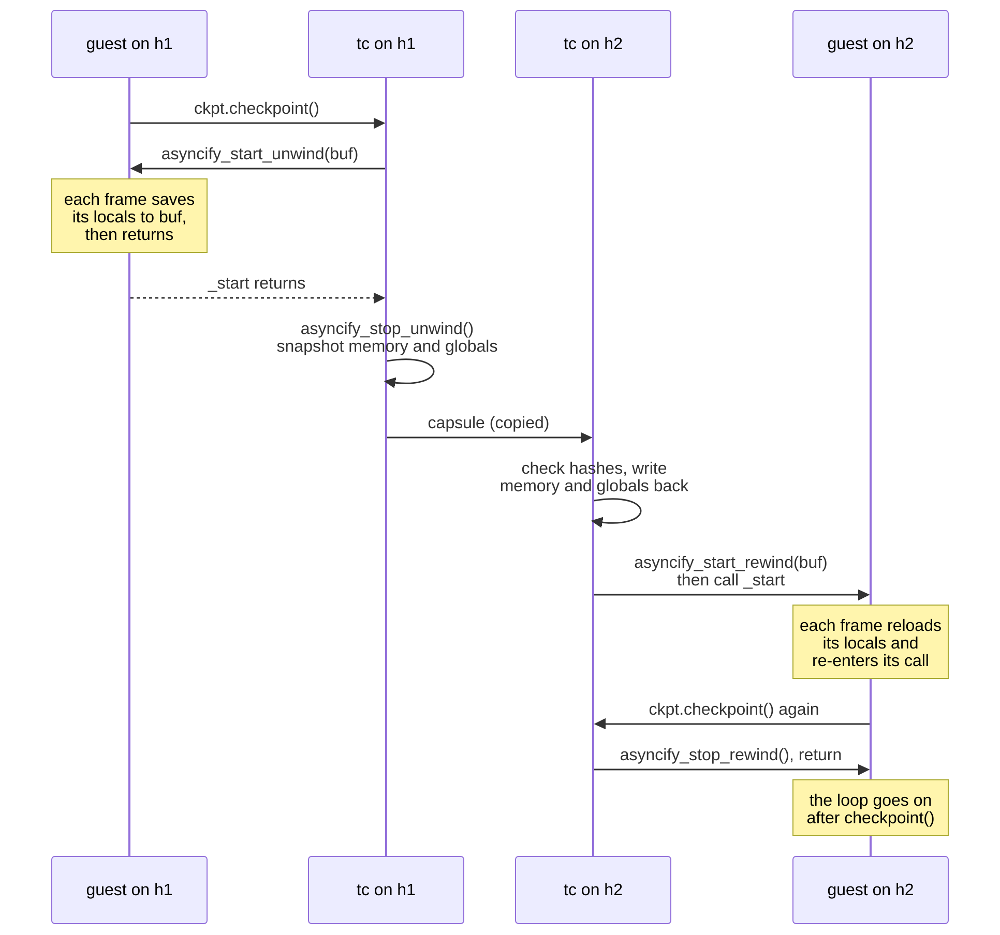
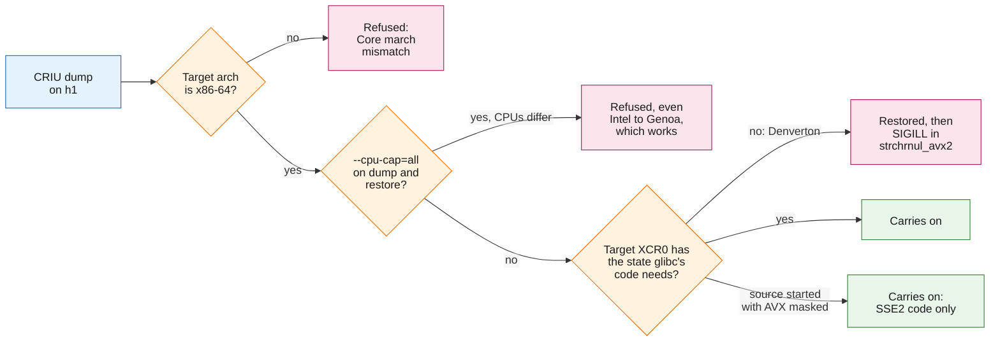
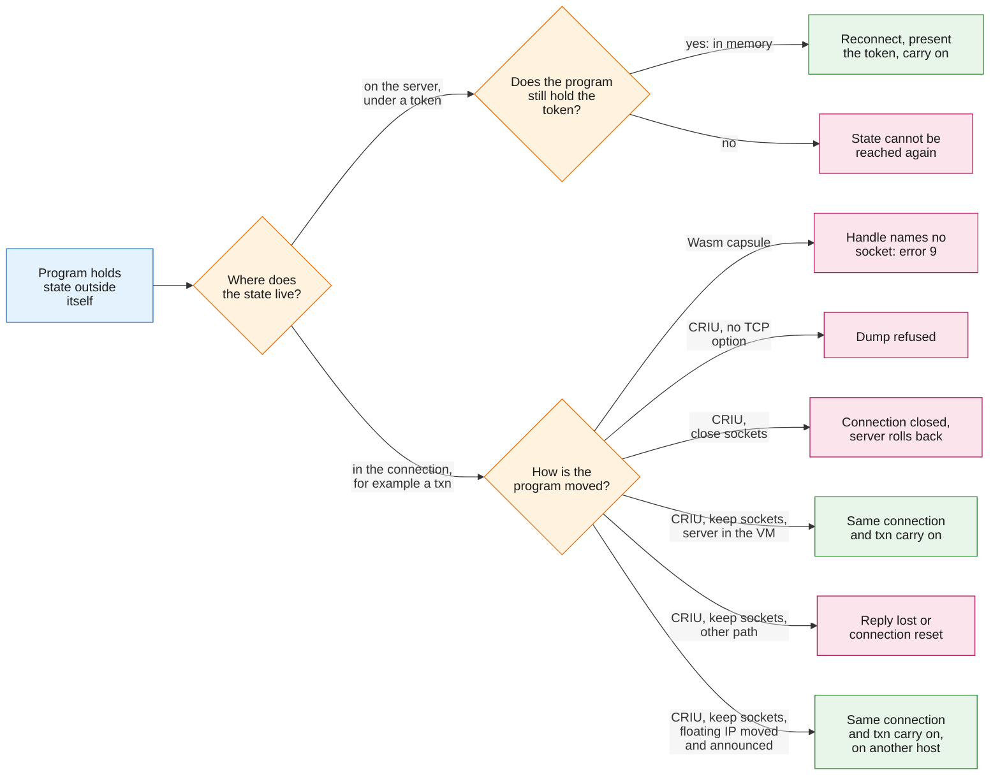

# Results: teleporting a running counter across CPU architectures

This document explains each experiment and quotes its output. It is the long form of the [README](../README.md), which says how to run them. The design notes are in [design.md](design.md), and the capsule format is in [capsule-format.md](capsule-format.md).

## At a glance: does the counter survive the move?



A native process carries machine code chosen for the CPU it started on, so it
can only move to a CPU that runs that code. A Wasm capsule carries no machine
code, so every target compiles the program afresh. (Colours: blue = step,
orange = decision, green = the counter carries on, pink = refused or crashed.)

> **What is real and what is not.** Every output block in this document is pasted from a run of the matching `make` target (the README gives the order). Nothing is simulated, but the hosts are VMs on one machine:
>
> - **h1, h4 and h5 run on KVM** (the Linux kernel's hypervisor: guest code runs directly on the real CPU). QEMU's CPU *model* sets what CPUID (the CPU-identification instruction) reports, while the instructions run on the host's real CPU underneath. Section 6 shows why that difference matters.
> - **h2 (aarch64) and h3 (riscv64) run under TCG** (Tiny Code Generator: QEMU's software CPU emulator). Their CPUs are emulated Neoverse N1 and RV64 cores, not real Arm or RISC-V silicon.
> - **The "network"** between hosts is a copy, on this machine, from one VM's shared directory to the next.
>
> **Not run:** the AVX-512 case for CRIU. AVX-512 (Advanced Vector Extensions, 512-bit: Intel's widest vector instructions) is missing from the CPU that these runs used, and neither KVM nor TCG can supply it; section 6 uses AVX instead. Also not run: the Go-on-WASI experiment, the ideas listed in [design.md](design.md), and real Arm or RISC-V hardware.

## 1. Four hosts, three ISAs

An ISA (instruction set architecture) is the machine language a CPU runs:
x86-64, AArch64 and RISC-V are three different ones. Each host is a QEMU VM
that boots the Debian 13 "generic" cloud image for its ISA, verified against
Debian's `SHA512SUMS` ([vms/fetch-images.sh](../vms/fetch-images.sh)).
[vms/common.sh](../vms/common.sh) gives each one a copy-on-write disk, a
cloud-init seed (user `teleport`, an SSH (Secure Shell: encrypted
remote login) key that it generates), an SSH port, and a
shared directory over 9p (the Plan 9 file protocol, which QEMU serves to the
guest over virtio): `vms/shared/<host>` on this machine is `/mnt/shared` in the
VM.

| Host | QEMU | `-cpu` | Accel | SSH port | Stands for |
|---|---|---|---|---|---|
| h1 | `qemu-system-x86_64` | `Icelake-Server` | KVM | 2221 | an Intel cloud VM |
| h2 | `qemu-system-aarch64` | `neoverse-n1` | TCG | 2222 | AWS Graviton 2, Ampere Altra |
| h3 | `qemu-system-riscv64` | `rv64` | TCG | 2223 | a RISC-V board |
| h4 | `qemu-system-x86_64` | `EPYC-Genoa` (default) | KVM | 2224 | an AMD cloud VM; section 6 reboots it as `Opteron_G4` and `Denverton` |

All four hosts are hops of the teleport demos, in this order: h1 (x86-64, Intel model), h2 (AArch64), h3 (RISC-V), h4 (x86-64, AMD model). The last hop returns to x86-64, on a CPU model from a different vendor than h1.

The aarch64 and riscv64 VMs boot through UEFI (Unified Extensible Firmware
Interface: the standard PC and server firmware) from the distro's EDK2
packages; riscv64 also uses QEMU's bundled OpenSBI. The check that each host is what it claims to be is `make hosts`, which runs `uname -m` and reads `/proc/cpuinfo` on each one
([results/hosts.txt](../results/hosts.txt)). The SSH ports above are the defaults; set `SSH_PORT_BASE` to move them:

```text
EXPERIMENT  Show the four hosts
QUESTION    Which architecture, CPU model and kernel does each VM have?
HOW         The CPU line is what the guest kernel reads from /proc/cpuinfo. x86-64 reports a model name. Arm reports an implementer and a part number. RISC-V reports an ISA string.

[1/4] h1: x86_64, CPU model Icelake-Server, runs on the real CPU (KVM)
  do    ask h1 for its architecture, CPU and kernel
  raw   x86_64
  raw   model name : Intel Xeon Processor (Icelake)
  raw   model name : Intel Xeon Processor (Icelake)
  raw   6.12.117+deb13-amd64

[2/4] h2: aarch64, CPU model neoverse-n1, emulated in software (QEMU TCG)
  do    ask h2 for its architecture, CPU and kernel
  raw   aarch64
  raw   CPU implementer : 0x41
  raw   CPU part : 0xd0c
  raw   CPU implementer : 0x41
  raw   6.12.117+deb13-arm64

[3/4] h3: riscv64, CPU model rv64, emulated in software (QEMU TCG)
  do    ask h3 for its architecture, CPU and kernel
  raw   riscv64
  raw   isa : rv64imafdch_zicbom_zicboz_zicntr_zicsr_zifencei_zihintntl_zihintpause_zihpm_zawrs_zfa_zca_zcd_zba_zbb_zbc_zbs_sstc_svvptc
  raw   isa : rv64imafdch_zicbom_zicboz_zicntr_zicsr_zifencei_zihintntl_zihintpause_zihpm_zawrs_zfa_zca_zcd_zba_zbb_zbc_zbs_sstc_svvptc
  raw   6.12.117+deb13-riscv64

[4/4] h4: x86_64, CPU model EPYC-Genoa, runs on the real CPU (KVM)
  do    ask h4 for its architecture, CPU and kernel
  raw   x86_64
  raw   model name : AMD EPYC-Genoa Processor
  raw   model name : AMD EPYC-Genoa Processor
  raw   6.12.117+deb13-amd64

RESULT  DONE (4 hosts shown)
```

Arm CPUs report no model name. The kernel prints the MIDR (Main ID Register:
the Arm register that identifies the CPU's designer and part number) instead;
implementer 0x41 is Arm Ltd and part 0xd0c is the Neoverse N1 (background:
Arm's part numbers as I recall them, not checked against Arm's documents here;
QEMU's `-cpu neoverse-n1` is what set them).

**h1 is not a complete Icelake.** KVM can only offer features the real CPU
has, and the host CPU lacks AVX-512, HLE (Hardware Lock
Elision) and RTM (Restricted Transactional Memory), the last two being Intel's
transactional-memory features. QEMU warns and drops them; there are
14 distinct warnings, each printed twice ([results/h1.qemu.log](../results/h1.qemu.log)):

```text
qemu-system-x86_64: warning: host doesn't support requested feature: CPUID[eax=07h,ecx=00h].EBX.hle [bit 4]
qemu-system-x86_64: warning: host doesn't support requested feature: CPUID[eax=07h,ecx=00h].EBX.rtm [bit 11]
qemu-system-x86_64: warning: host doesn't support requested feature: CPUID[eax=07h,ecx=00h].EBX.avx512f [bit 16]
...
```

TCG cannot fill the gap either. Asked for `Icelake-Server,enforce`, QEMU
11.1.2 printed `TCG doesn't support requested feature: ...avx512f`, among
others.

## 2. Why a Wasm program can move and a native one cannot

A native program is machine code for one ISA, and its saved state includes
that ISA's registers and code addresses. A Wasm program is compiled on each
machine, so its *code* never has to move. What has to move is its *state*,
and a Wasm instance keeps its state in places the Wasm spec defines for every
machine alike:

- **linear memory**, a flat byte array. The spec fixes its byte order as
  little-endian on every host (from the source: the WebAssembly core spec's
  memory instructions), so the same bytes mean the same values on x86-64,
  aarch64 and riscv64;
- **globals**, typed values such as `__stack_pointer`;
- **WASI state** (WASI: the WebAssembly System Interface, the guest's
  POSIX-like view of arguments, files and clocks), which lives in the host.

The host runtime, [`tc`](../crates/tc/src/main.rs), is built on the `wasmtime` crate,
pinned at 51.0.0. It saves those three things into a **capsule**: a directory
of `manifest.json`, `memory.bin`, `globals.json` and `wasi.json`, specified in
[docs/capsule-format.md](capsule-format.md).

`tc` itself is native code, so it is built once per ISA (`make host`). The
aarch64 build is a static musl binary. The riscv64 build links against glibc
instead: wasmtime's trap handler reads the faulting PC and SP from the signal
context through register constants (`REG_PC`, `REG_SP`, ...) that the `libc`
crate defines for riscv64 glibc but not for riscv64 musl, and the musl build
failed with `cannot find value REG_PC in crate libc`. zig supplies the cross
glibc 2.41 to link against ([.cargo/config.toml](../.cargo/config.toml)).



Only the green parts cross from one machine to the next. Each host turns the
same `.wasm` file into its own machine code. (Blue = per-host step, green =
the capsule's files.)

Restore is fail-closed. It refuses a capsule whose module hash, wasmtime
version, file hashes, arguments, preopened directories, globals or Asyncify
buffer address do not match. Each of those refusals has a test that breaks
exactly that one thing (section 7).

## 3. Experiment 1: paused between calls

The first guest, [guests/step-counter](../guests/step-counter/src/lib.rs), is
Rust compiled to `wasm32-wasip1`. It exports `step()`, which adds 1 to a
`static` counter in linear memory and returns it. Between two calls to
`step()` no Wasm function is running, so memory plus globals is the whole
state. `tc start` calls `step()` 1000 times and writes a capsule; `tc resume`
on the next host checks it, writes the state back and calls `step()` 1000 more
times (`make demo-step`, [results/demo-step.txt](../results/demo-step.txt)):

```text
EXPERIMENT  Move a counter that is paused between function calls
QUESTION    Does the counter keep counting when its program moves to a host with another CPU type?
HOW         Each host runs the same WebAssembly program. Each host runs it for 1000 steps, saves its state as a capsule (a directory of files), and the capsule is copied to the next host.

[1/4] h1: x86_64, CPU model Icelake-Server, runs on the real CPU (KVM)
  do    start the program and run it until it asks to be paused, then save its state as a capsule
  got   saved capsule 5fce1b20: program memory 1088KiB, progress counter 1000
  next  copy the capsule from h1 to h2 (1.1M)
  raw   tc: checkpoint host=h1 arch=x86_64 cpu="Intel Xeon Processor (Icelake)" counter=1000 capsule=sha256:5fce1b20e50e module=sha256:7e1089aecc74 memory=1088KiB

[2/4] h2: aarch64, CPU model neoverse-n1, emulated in software (QEMU TCG)
  do    load the capsule that h1 saved, check its hashes, and continue the program from where it stopped
  got   capsule 5fce1b20 loaded and verified (written on h1, x86_64); progress counter 1000 at that point
  got   paused again, saved capsule 6535c39c, progress counter 2000
  next  copy the capsule from h2 to h3 (1.1M)
  raw   tc: restored on h2 (aarch64, "Arm Neoverse-N1 (implementer 0x41, part 0xd0c)") from capsule=sha256:5fce1b20e50e written on h1 (x86_64) counter=1000 module=sha256:7e1089aecc74 verified
  raw   tc: checkpoint host=h2 arch=aarch64 cpu="Arm Neoverse-N1 (implementer 0x41, part 0xd0c)" counter=2000 capsule=sha256:6535c39c8940 module=sha256:7e1089aecc74 memory=1088KiB

[3/4] h3: riscv64, CPU model rv64, emulated in software (QEMU TCG)
  do    load the capsule that h2 saved, check its hashes, and continue the program from where it stopped
  got   capsule 6535c39c loaded and verified (written on h2, aarch64); progress counter 2000 at that point
  got   paused again, saved capsule f7764191, progress counter 3000
  next  copy the capsule from h3 to h4 (1.1M)
  raw   tc: restored on h3 (riscv64, "rv64imafdch (no uarch)") from capsule=sha256:6535c39c8940 written on h2 (aarch64) counter=2000 module=sha256:7e1089aecc74 verified
  raw   tc: checkpoint host=h3 arch=riscv64 cpu="rv64imafdch (no uarch)" counter=3000 capsule=sha256:f77641910477 module=sha256:7e1089aecc74 memory=1088KiB

[4/4] h4: x86_64, CPU model EPYC-Genoa, runs on the real CPU (KVM)
  do    load the capsule that h3 saved, check its hashes, and continue the program from where it stopped
  got   capsule f7764191 loaded and verified (written on h3, riscv64); progress counter 3000 at that point
  got   ran to the end, progress counter 4000
  raw   tc: restored on h4 (x86_64, "AMD EPYC-Genoa Processor") from capsule=sha256:f77641910477 written on h3 (riscv64) counter=3000 module=sha256:7e1089aecc74 verified
  raw   tc: ran to counter=4000, done

CHECK   Does this transcript show what the README says it shows?
  ok    the hosts ran in this order: h1 (x86_64), h2 (aarch64), h3 (riscv64), h4 (x86_64)
  ok    each host loaded exactly the capsule that the previous host saved
  ok    every host ran the same program (module 7e1089ae)
  ok    the counter went 1000, 2000, 3000, 4000: each host started where the previous one stopped

RESULT  PASS
```

1000 → 2000 → 3000 → 4000, with the same module hash on all four hosts. The `make demo-step` target took 5 s in this run (wall time of the whole target: four SSH sessions, the copies and the check).

**The counter is just bytes.** [scripts/check/crosscheck.py](../scripts/check/crosscheck.py) never asks `tc`
where the counter lives. It reads the address from the module's own code (the
`i64.load offset=1048584` inside `step`, via binaryen's `wasm-dis`), then
reads 8 bytes at that address out of `memory.bin` with Python:

```text
  got   the step counter lives at linear-memory address 1048584 (found by disassembling the module with wasm-dis)
  ok    vms/shared/h1/capsules/wasm-step/cap-0: written on h1 (x86_64), module step-counter.wasm; all three hashes match; the counter read from memory.bin is 1000
  ok    vms/shared/h2/capsules/wasm-step/cap-1: written on h2 (aarch64), module step-counter.wasm; all three hashes match; the counter read from memory.bin is 2000
  ok    vms/shared/h3/capsules/wasm-step/cap-2: written on h3 (riscv64), module step-counter.wasm; all three hashes match; the counter read from memory.bin is 3000
```

The capsule is 1088 KiB for an 8-byte counter. Most of that is the 1 MiB
shadow stack (the C-style call stack that Rust and C keep in linear memory),
which is almost all zeros. The format stores memory raw; see
"What these experiments does not cover".

## 4. Experiment 2: paused mid-loop, call stack and all

Pausing *inside* a call is harder: the live frames sit on the native stack of
whichever CPU is running them, in that CPU's registers and layout. Binaryen's
**Asyncify** pass solves this at the Wasm level. It rewrites every function
that can reach a chosen import, so that the function can save its locals and
its position into a buffer in linear memory and return early ("unwind"), and
later re-enter and jump back to where it was ("rewind"). (Background: Alon
Zakai's 2019 post *Pause and Resume WebAssembly with Binaryen's Asyncify*
describes the transform. Everything below is as observed.)

The guest, [guests/async-counter](../guests/async-counter/src/main.rs), counts
to 4000 in a *local variable* inside `main`. It keeps a heap-allocated
`history` vector and its start time, and calls the import `ckpt.checkpoint()`
every 1000 iterations. Its build runs
`wasm-opt --asyncify --pass-arg=asyncify-imports@ckpt.checkpoint`, so only
code that can reach that import is instrumented. `tc` drives the protocol
([crates/tc/src/runtime.rs](../crates/tc/src/runtime.rs)):



The left half runs on h1 and the right half on h2. Between them, the call
stack exists only as bytes in linear memory.

`make demo-async` ([results/demo-async.txt](../results/demo-async.txt); the target took 8 s in this run):

```text
EXPERIMENT  Move a loop that is paused in the middle of its run
QUESTION    Does the loop carry on from the exact point where it was paused, with its variables intact, on a host with another CPU type?
HOW         The program calls checkpoint() every 250 iterations. A paused program is saved as a capsule, copied to the next host, and loaded there.

[1/4] h1: x86_64, CPU model Icelake-Server, runs on the real CPU (KVM)
  do    start the program and run it until it asks to be paused, then save its state as a capsule
  got   saved capsule 8c8f1563: program memory 1152KiB, progress counter 1000
  next  copy the capsule from h1 to h2 (1.2M)
  prog  i=250 sum_sq=5239625 history=[] t=0ms
  prog  i=500 sum_sq=41791750 history=[] t=1ms
  prog  i=750 sum_sq=140906375 history=[] t=1ms
  prog  i=1000 sum_sq=333833500 history=[] t=1ms
  raw   tc: checkpoint host=h1 arch=x86_64 cpu="Intel Xeon Processor (Icelake)" counter=1000 capsule=sha256:8c8f1563bac2 module=sha256:cfa2985435f4 memory=1152KiB

[2/4] h2: aarch64, CPU model neoverse-n1, emulated in software (QEMU TCG)
  do    load the capsule that h1 saved, check its hashes, and continue the program from where it stopped
  got   capsule 8c8f1563 loaded and verified (written on h1, x86_64); progress counter 1000 at that point
  got   paused again, saved capsule 59eb47ed, progress counter 2000
  next  copy the capsule from h2 to h3 (1.2M)
  prog  i=1250 sum_sq=651823125 history=[1000] t=56ms
  prog  i=1500 sum_sq=1126125250 history=[1000] t=79ms
  prog  i=1750 sum_sq=1787989875 history=[1000] t=80ms
  prog  i=2000 sum_sq=2668667000 history=[1000] t=80ms
  raw   tc: restored on h2 (aarch64, "Arm Neoverse-N1 (implementer 0x41, part 0xd0c)") from capsule=sha256:8c8f1563bac2 written on h1 (x86_64) counter=1000 module=sha256:cfa2985435f4 verified
  raw   tc: checkpoint host=h2 arch=aarch64 cpu="Arm Neoverse-N1 (implementer 0x41, part 0xd0c)" counter=2000 capsule=sha256:59eb47edcf36 module=sha256:cfa2985435f4 memory=1152KiB

[3/4] h3: riscv64, CPU model rv64, emulated in software (QEMU TCG)
  do    load the capsule that h2 saved, check its hashes, and continue the program from where it stopped
  got   capsule 59eb47ed loaded and verified (written on h2, aarch64); progress counter 2000 at that point
  got   paused again, saved capsule 061590f8, progress counter 3000
  next  copy the capsule from h3 to h4 (1.2M)
  prog  i=2250 sum_sq=3799406625 history=[1000, 2000] t=135ms
  prog  i=2500 sum_sq=5211458750 history=[1000, 2000] t=158ms
  prog  i=2750 sum_sq=6936073375 history=[1000, 2000] t=158ms
  prog  i=3000 sum_sq=9004500500 history=[1000, 2000] t=158ms
  raw   tc: restored on h3 (riscv64, "rv64imafdch (no uarch)") from capsule=sha256:59eb47edcf36 written on h2 (aarch64) counter=2000 module=sha256:cfa2985435f4 verified
  raw   tc: checkpoint host=h3 arch=riscv64 cpu="rv64imafdch (no uarch)" counter=3000 capsule=sha256:061590f80b9e module=sha256:cfa2985435f4 memory=1152KiB

[4/4] h4: x86_64, CPU model EPYC-Genoa, runs on the real CPU (KVM)
  do    load the capsule that h3 saved, check its hashes, and continue the program from where it stopped
  got   capsule 061590f8 loaded and verified (written on h3, riscv64); progress counter 3000 at that point
  got   the program finished by itself, exit code 0
  prog  i=3250 sum_sq=11447990125 history=[1000, 2000, 3000] t=161ms
  prog  i=3500 sum_sq=14297792250 history=[1000, 2000, 3000] t=162ms
  prog  i=3750 sum_sq=17585156875 history=[1000, 2000, 3000] t=162ms
  prog  i=4000 sum_sq=21341334000 history=[1000, 2000, 3000] t=162ms
  prog  done: i=4000 sum_sq=21341334000 (expected 21341334000) history=[1000, 2000, 3000]
  raw   tc: restored on h4 (x86_64, "AMD EPYC-Genoa Processor") from capsule=sha256:061590f80b9e written on h3 (riscv64) counter=3000 module=sha256:cfa2985435f4 verified
  raw   tc: guest finished (exit 0)

CHECK   Does this transcript show what the README says it shows?
  ok    the hosts ran in this order: h1 (x86_64), h2 (aarch64), h3 (riscv64), h4 (x86_64)
  ok    each host loaded exactly the capsule that the previous host saved
  ok    every host ran the same program (module cfa29854)
  ok    the loop printed i = 250, 500, ... 4000 in order, 1000 iterations on each host, and the running sum and the history were correct each time
  ok    the program finished by itself on h4 (exit 0), with sum_sq 21341334000

RESULT  PASS
```

What carried across:

- **the loop variable**, a local in a frame that was live at the pause:
  i = 1250 is the first line on h2;
- **the heap**: `history` grows `[1000]` → `[1000, 2000]` → `[1000, 2000, 3000]` across machines;
- **no iteration lost or repeated**: `sum_sq` ends at the closed-form value
  4000·4001·8001/6;
- **the guest's clock**: `t` never goes back (its last value on each host is 1 → 80 → 158 → 162 ms). WASI's
  monotonic clock would start again at zero on each host, so `tc` saves the
  guest's clock reading in `wasi.json` and starts the next host's clock from
  it.

**Without `__stack_pointer`, the guest crashes.** The shadow-stack pointer is
a global. Unwinding leaves it where the deepest frame put it, and rewinding
skips the code that would set it again, so it must travel with the capsule.
That is why the build exports it (`--export=__stack_pointer`, which wasm-ld
hides by default). The test `the_stack_pointer_must_travel` resets it to its
initial value before resuming, and the guest stops with a trap:

```text
without the saved stack pointer: Err("error while executing at wasm backtrace:\n    0:   0xf020 - <unknown>!<wasm function 193>\n ... wasm trap: indirect call type mismatch")
```

The resumed guest's new calls wrote over the rewound frames, and a function
pointer among them was corrupted. Wasm checks the type of every indirect
call, so the bad pointer became a clean trap instead of a jump to the wrong
code.

**Asyncify costs code size.** The same `wasm-opt` pipeline with and without
`--asyncify` gives 63,360 → 106,914 bytes for this guest (+69%) and
27,329,200 → 31,654,516 bytes for CPython (+16%). Run-time overhead was not
measured.

**Wasmer's journaling was tried and not adopted.** the design notes suggested
trying it before writing this host. In a time-boxed attempt, Wasmer 7.5.0 did
not take a mid-run snapshot of a test guest with any trigger tried; see
[results/wasmer-spike.md](../results/wasmer-spike.md).

### Where is `checkpoint()` implemented?

The guest calls `checkpoint()`, but the guest does not contain its code. The function lives in the host program `tc`, and the guest only names it. This subsection follows that call, from the guest to the host. All code below is *from the source*, read in this session from this repository, and the host uses wasmtime 51.0.0 (the version that `cargo` compiled here).

**1. The guest declares an import.** A Wasm import is a function that the module calls but does not define. The host must supply it when it creates the instance. [guests/async-counter/src/main.rs](../guests/async-counter/src/main.rs), lines 13 to 15 and 59:

```rust
#[link(wasm_import_module = "ckpt")]
unsafe extern "C" {
    fn checkpoint();
}
// ...
                checkpoint();
```

`wasm_import_module = "ckpt"` sets the module half of the import name, and the function name `checkpoint` is the other half. Together they give the Wasm import `ckpt.checkpoint`. The Rust code has no body for it. The Python guest does the same from C, in [guests/py-counter/_ckptmodule.c](../guests/py-counter/_ckptmodule.c).

**2. The host registers a function under that name.** wasmtime's `Linker` is the table of imports that the host offers. [crates/tc/src/runtime.rs](../crates/tc/src/runtime.rs), in `Guest::instantiate` (which `fresh` and `restore` both call):

```rust
linker.func_wrap("ckpt", "checkpoint", checkpoint)?;
let instance = linker.instantiate(&mut store, &module)?;
```

`func_wrap` binds the name `ckpt.checkpoint` to the Rust function `checkpoint` in the same file. If a module imports a name that the linker does not hold, `instantiate` fails. So a guest can only call `checkpoint()` under `tc`.

**3. The host function reads Asyncify's state and chooses one of three actions.** Asyncify (the Binaryen pass from section 4) adds a state variable to the module, and the export `asyncify_get_state` reads it. The two states that matter have these values in [crates/tc/src/runtime.rs](../crates/tc/src/runtime.rs):

```rust
const ASYNCIFY_NORMAL: i32 = 0;
const ASYNCIFY_REWINDING: i32 = 2;
```

The same file, `fn checkpoint`, trimmed: the `expect` messages and the header-writing lines are left out, and the comments are mine.

```rust
fn checkpoint(mut caller: Caller<'_, HostState>) -> Result<()> {
    // Ask the module which Asyncify state it is in.
    /* state = asyncify_get_state() */
    match state[0].unwrap_i32() {
        // Resuming from a capsule: the frames are back, so stop rewinding.
        ASYNCIFY_REWINDING => {
            /* call asyncify_stop_rewind() */
            caller.data_mut().rewound = true;
            Ok(())
        }
        // Normal run, and the host asked for a pause: start unwinding.
        ASYNCIFY_NORMAL if caller.data().unwind_at_next => {
            /* write the buffer header, then call asyncify_start_unwind(buf) */
            data.unwound = true;
            data.unwind_at_next = false;
            Ok(())
        }
        // Normal run, no pause requested: do nothing, the guest goes on.
        ASYNCIFY_NORMAL => Ok(()),
        s => bail!("ckpt.checkpoint() reached in Asyncify state {s}"),
    }
}
```

| Asyncify state | `unwind_at_next` | What the host does | What happens next |
| --- | --- | --- | --- |
| rewinding (2) | any | calls `asyncify_stop_rewind`, sets `rewound` | the guest continues after `checkpoint()` |
| normal (0) | true | writes the buffer header, calls `asyncify_start_unwind(buf)`, sets `unwound` | every frame saves its locals and returns, then `tc` takes the capsule |
| normal (0) | false | nothing | the guest continues at once |
| any other | any | returns an error | the run stops |

The buffer header is two 32-bit integers that Asyncify expects at the start of its buffer: the next free byte (`buf + 8`) and the end of the buffer (`buf + size`).

**4. The host function does not take the capsule itself.** `checkpoint` only starts the unwind and returns. The call stack unwinds, and the entry export returns to `tc`. Then `Guest::run_async`, in the same file, sees `unwound` and calls `asyncify_stop_unwind`. After that `tc` copies out memory and globals.

**5. The same function serves both directions.** Resume uses the same import. `Guest::run_async` calls `asyncify_start_rewind(buf)` and calls the entry export again. The frames reload, the guest reaches `checkpoint()` once more, and the host takes the `ASYNCIFY_REWINDING` arm. If the guest never reaches it, `run_async` stops with "the rewind never reached ckpt.checkpoint()".

**What was run.** `cargo test checkpoint` in `crates/tc/` ran two tests, and both passed. `checkpoint_needs_asyncify` calls a module that imports `ckpt.checkpoint` but was not Asyncify'd, and expects the error "the module is not Asyncify'd". `refuses_a_rewind_that_never_reaches_the_checkpoint` expects the rewind error in step 5. Neither test runs the three-hop demo; the demo output earlier in this section is from the earlier `make demo-async` run.

## 5. Experiment 3: CPython on WebAssembly, paused mid-script

The same mechanism, applied to a whole interpreter.
[guests/py-counter/build.sh](../guests/py-counter/build.sh) builds CPython
3.15.2 for `wasm32-wasip1` with its own `Platforms/WASI` tooling and wasi-sdk
33, the version CPython 3.15 declares. It adds one C module,
[`_ckpt`](../guests/py-counter/_ckptmodule.c), whose `checkpoint()` calls the
host import, then runs the Asyncify pass over the result. The script is
design.md's ([app/counter.py](../guests/py-counter/app/counter.py)):

```python
total = 0
for i in range(40):
    total += i
    print(f"hello world {i} total={total}")
    if i in (9, 19, 29):
        _ckpt.checkpoint()
```

`make demo-py` ([results/demo-py.txt](../results/demo-py.txt), abridged):

```text
EXPERIMENT  Move a Python script that is paused in the middle of its run
QUESTION    Does a Python script, running inside WebAssembly, carry on after a move with its variables intact and without restarting the interpreter?
HOW         The script calls checkpoint() after the 10th and the 20th line. A paused program is saved as a capsule, copied to the next host, and loaded there.

[1/4] h1: x86_64, CPU model Icelake-Server, runs on the real CPU (KVM)
  do    start the program and run it until it asks to be paused, then save its state as a capsule
  got   saved capsule 160f8b2e: program memory 40960KiB, no progress counter (this program has none)
  next  copy the capsule from h1 to h2 (41M)
  prog  python 3.15.2 on wasi/wasm32
  prog  hello world 0 total=0
  prog  ... (8 more lines)
  prog  hello world 9 total=45
  raw   tc: checkpoint host=h1 arch=x86_64 cpu="Intel Xeon Processor (Icelake)" counter=- capsule=sha256:160f8b2ed760 module=sha256:a4d3f3889fa9 memory=40960KiB

[2/4] h2: aarch64, CPU model neoverse-n1, emulated in software (QEMU TCG)
  do    load the capsule that h1 saved, check its hashes, and continue the program from where it stopped
  got   capsule 160f8b2e loaded and verified (written on h1, x86_64); no progress counter (this program has none) at that point
  got   paused again, saved capsule f02cff37, no progress counter (this program has none)
  next  copy the capsule from h2 to h3 (41M)
  prog  hello world 10 total=55
  prog  hello world 11 total=66
  prog  ... (7 more lines)
  prog  hello world 19 total=190
  raw   tc: restored on h2 (aarch64, "Arm Neoverse-N1 (implementer 0x41, part 0xd0c)") from capsule=sha256:160f8b2ed760 written on h1 (x86_64) counter=- module=sha256:a4d3f3889fa9 verified
  raw   tc: checkpoint host=h2 arch=aarch64 cpu="Arm Neoverse-N1 (implementer 0x41, part 0xd0c)" counter=- capsule=sha256:f02cff379789 module=sha256:a4d3f3889fa9 memory=40960KiB

[3/4] h3: riscv64, CPU model rv64, emulated in software (QEMU TCG)
  do    load the capsule that h2 saved, check its hashes, and continue the program from where it stopped
  got   capsule f02cff37 loaded and verified (written on h2, aarch64); no progress counter (this program has none) at that point
  got   paused again, saved capsule 41a04a13, no progress counter (this program has none)
  next  copy the capsule from h3 to h4 (41M)
  prog  hello world 20 total=210
  prog  hello world 21 total=231
  prog  ... (7 more lines)
  prog  hello world 29 total=435
  raw   tc: restored on h3 (riscv64, "rv64imafdch (no uarch)") from capsule=sha256:f02cff379789 written on h2 (aarch64) counter=- module=sha256:a4d3f3889fa9 verified
  raw   tc: checkpoint host=h3 arch=riscv64 cpu="rv64imafdch (no uarch)" counter=- capsule=sha256:41a04a13b926 module=sha256:a4d3f3889fa9 memory=40960KiB

[4/4] h4: x86_64, CPU model EPYC-Genoa, runs on the real CPU (KVM)
  do    load the capsule that h3 saved, check its hashes, and continue the program from where it stopped
  got   capsule 41a04a13 loaded and verified (written on h3, riscv64); no progress counter (this program has none) at that point
  got   the program finished by itself, exit code 0
  prog  hello world 30 total=465
  prog  hello world 31 total=496
  prog  ... (7 more lines)
  prog  hello world 39 total=780
  raw   tc: restored on h4 (x86_64, "AMD EPYC-Genoa Processor") from capsule=sha256:41a04a13b926 written on h3 (riscv64) counter=- module=sha256:a4d3f3889fa9 verified
  raw   tc: guest finished (exit 0)

CHECK   Does this transcript show what the README says it shows?
  ok    the hosts ran in this order: h1 (x86_64), h2 (aarch64), h3 (riscv64), h4 (x86_64)
  ok    each host loaded exactly the capsule that the previous host saved
  ok    every host ran the same program (module a4d3f388)
  ok    the interpreter started once, on h1, and the script printed 'hello world' 0 to 39 in order, ten on each host, with the right total

RESULT  PASS
```

i = 0–9 print on x86-64 (Intel), 10–19 on aarch64, 20–29 on riscv64 and 30–39 on x86-64 (AMD), with `total`
continuous: design.md's "done when" for experiment 3, asserted by
[scripts/check/checkdemo.py](../scripts/check/checkdemo.py) on every `make demo-py` (section 7). The interpreter's whole state
(the frame of the running script, the `range` iterator, the integer objects,
the import system) is in those 40 MiB of linear memory. The C stack from
`main` down through the eval loop to `_ckpt.checkpoint` is in the Asyncify
buffer inside it. The `make demo-py` target took 12 s in this run.

Details that took a while to find:

- **The unflushed print buffer travelled too.** In a first run without `-u`,
  every line appeared at the very end, on the last host. stdout was not a
  terminal, so CPython buffered it, and the buffer sat in linear memory and
  crossed three machines inside the capsules. The demo runs `python -u`
  (unbuffered).
- **`Modules/Setup.local` is read from the build directory.** CPython's WASI
  build is out-of-tree, so `_ckpt` has to be listed in
  `cross-build/wasm32-wasip1/Modules/Setup.local`. The copy in the checkout
  was silently ignored.
- **The build itself runs `python.wasm`** under the wasmtime CLI, which knows
  nothing of `ckpt.checkpoint`. `build.sh` sets wasmtime's
  `unknown-imports-trap` option for those build-time runs, which never call it.
- **JIT under emulation is slow, so it is avoided.** JIT (just-in-time:
  compiling the module when it is loaded) of the 31 MB module would run
  inside TCG on h2 and h3. Instead `tc precompile` compiles it on this machine
  ahead of time (AOT) for each target, about one second each. The `.cwasm`
  files are named by the sha256 of the `.wasm` they came from, so the module
  check still covers the code that runs.

## 6. Experiment 4: CRIU on the same moves

CRIU is how containers are usually moved. Here it gets the same moves, with the same counter written in C
([guests/criu-counter/counter.c](../guests/criu-counter/counter.c)) and linked
against Debian's glibc 2.41. The whole table, with raw output for every row,
is in [results/criu.md](../results/criu.md):

| Move | Target `-cpu` | `criu restore` | Then |
|---|---|---|---|
| h1 → h2 | `neoverse-n1` (aarch64) | `Error (criu/cr-restore.c:854): Core march mismatch 1` | — |
| h1 → h4 | `EPYC-Genoa` | exit 0 | carries on, same PID (process ID) |
| h1 → h4 | `Opteron_G4` (no AVX2) | exit 0 | carries on |
| h1 → h4 | `Denverton` (no AVX) | exit 0 | `trap invalid opcode ... in libc.so.6[164c40,...]` |
| h1 → h4 | `Denverton`, `GLIBC_TUNABLES=glibc.cpu.hwcaps=-AVX2,-AVX` on h1 | exit 0 | carries on |
| h1 → h4 | `Denverton`, `--cpu-cap=all` | `cpu: CPU xfeatures has unsupported bits (0x204)` | — |
| h1 → h4 | `EPYC-Genoa`, `--cpu-cap=all` | `cpu: CPU instruction capabilities do not match run time` | — |
| h1 → h4 | `Denverton`, the **Wasm** counters | — | both finish |

Across ISAs, CRIU refuses outright. The image holds x86-64 registers and
code, and the arm64 CRIU checks the machine type. Within x86-64 the story is
subtler, in four steps.

**1. glibc picks its code once, for the CPU it starts on.** Functions such as
`strchrnul` have several versions: SSE2 (Streaming SIMD Extensions 2: x86-64's
baseline 128-bit vector instructions), AVX2 (Advanced Vector Extensions 2:
256-bit integer vector instructions) and EVEX (the AVX-512 encoding). An IFUNC (indirect
function: a glibc symbol whose implementation a resolver picks at load time
from CPUID) binds one of them when the process starts. On h1 that is the AVX2
one. CRIU then saves the process with that choice baked into its memory.

**2. A hidden CPUID bit does not remove the instruction.** The Opteron row
looked wrong at first: AVX2 code restored onto a CPU model without AVX2 kept
running. [isa-probe.c](../guests/criu-counter/isa-probe.c) shows why. It prints
what CPUID reports, prints XCR0 (extended
control register 0: the bit mask of register-state components the operating
system has enabled), then executes one instruction of each kind:

| Host | CPUID AVX / AVX2 | XCR0 | `vxorps ymm` (AVX) | `vpaddd ymm` (AVX2) |
|---|---|---|---|---|
| h1 `Icelake-Server` | 1 / 1 | `0x207` | ran | ran |
| h4 `Opteron_G4` | 1 / **0** | `0x7` | ran | **ran** |
| h4 `Denverton` | 0 / 0 | `0x3`, no YMM | SIGILL | SIGILL |

(SIGILL is the signal for an illegal instruction.) Under KVM the guest runs on
the real core, which has AVX2. A hypervisor can hide a feature in CPUID, but
it cannot make the core refuse that feature's instructions. What the core
*does* enforce is XCR0, which switches on whole groups of registers. AVX and
AVX2 both use the 256-bit YMM registers, bit 2 of XCR0, which Opteron_G4's
guest kernel enabled and Denverton's did not. (Background, as I recall Intel's
SDM (Software Developer's Manual): instructions with the AVX encoding raise an
invalid-opcode fault unless XCR0 enables AVX state. The probe agrees.) On a
real Opteron 6200, which has no AVX2 at all, the Opteron row would crash too.

**3. Where it died.** The kernel names the library and offset:
`libc.so.6[164c40,...]`. Debian's debug symbols for that exact libc, fetched
by build ID from `debuginfod.debian.net`, place it at the first instruction of
`__strchrnul_avx2` (which `snprintf` uses to scan its format string):

```text
$ addr2line -f -e libc.debug 0x164c40
__strchrnul_avx2
./string/../sysdeps/x86_64/multiarch/strchr-avx2.S:55
$ objdump -d --start-address=0x164c40 --stop-address=0x164c50 libc.so.6
  164c40:       c5 f9 6e c6             vmovd  %esi,%xmm0
```

`vmovd` is VEX-encoded (VEX: the instruction prefix that AVX introduced), so
on Denverton, with no AVX state enabled, it faults
at once. That is the first `snprintf` after the restore.

**4. CRIU's choices.** With default settings this CRIU 4.1.1 did not compare
the CPUs: it restored, and the process died. Asked to check (`--cpu-cap=all`
on both dump and restore), it refused Denverton: 0x204 is YMM (bit 2) plus
PKRU (bit 9, the protection-key register's state) in XCR0, both missing on
the target. It also refused Genoa, a move that works. So the check offers
"no check" or "exact match". The fix that worked was on the source side:
start the process with `GLIBC_TUNABLES=glibc.cpu.hwcaps=-AVX2,-AVX`. Measured
with `ld.so --list-diagnostics`, that tunable clears the two CPUID bits in
glibc's active set and drops `dl_platform` from `haswell` to `x86_64`, so the
process carries only SSE2 code. On glibc 2.41 the older spelling `-AVX2_Usable`
changed nothing.



A native image is only as portable as the most specific instruction its
libraries chose at start-up. Under KVM, "has that instruction" means the
XCR0 state is enabled, not that CPUID lists it. (Colours as above.)

The last row of the table is the point of these experiments: on the same move to
Denverton, both Wasm counters finished, because wasmtime compiled them on
Denverton for Denverton.

design.md's version of this experiment used AVX-512, but this machine cannot
run it. The host CPU has no AVX-512, so KVM drops it, and QEMU 11.1.2's TCG
reports `TCG doesn't support requested feature: ...avx512f`. AVX-512 has its
own XCR0 state components (bits 5–7), so as I understand it the same mechanism
would apply. That is not verified here.

### If a Wasm capsule moves across ISAs, why is CRIU still used?

Wasm solves the CPU problem. It does not solve the problem that CRIU solves, which is moving a normal Linux program. The two tools answer different questions, so these experiments does not show that one replaces the other.

| | Wasm capsule (sections 3 to 5) | CRIU |
| --- | --- | --- |
| What can move | a program built for Wasm and run by `tc` | any unmodified Linux process |
| What is saved | linear memory, globals, and the call stack through Asyncify | memory, registers, and the kernel's state for the process |
| Across ISAs | yes: the same module ran on four hosts, three ISAs | no: this section's table shows the failures |
| Open files, threads, child processes | not carried (*from the source*: [docs/capsule-format.md](capsule-format.md) and "What these experiments does not cover") | carried (*background*: not tested in these experiments) |
| Open network connections | not carried: the guest's handle names no socket on the next host (section 8, *run here*) | carried only with `--tcp-established`, and it worked in 1 of 3 runs that used it (section 8, *run here*) |
| Where it can pause | only where the guest calls `ckpt.checkpoint()` | almost anywhere (*background*) |

What these experiments shows about the limits of the Wasm side:

1. **The program must be rebuilt.** CPython needed its own WASI build (WASI, the WebAssembly System Interface: the small set of system calls that a Wasm program may use), a C module `_ckpt`, and the Asyncify pass (section 5). The normal `python3` binary of the machine cannot move this way.
2. **The guest sees only WASI.** WASI preview 1 has no threads, and a Wasm program cannot `fork`. Many real programs do not fit.
3. **The capsule is large.** It is 1.1 MB for an 8-byte counter and about 40 MiB for CPython, because memory is stored raw (section 3 and section 5).
4. **The guest chooses the pause point.** An external "stop now" trigger is not built.
5. **Run-time cost is not measured.** Only the size cost of Asyncify is.

What these experiments shows about the CRIU side is the CPU problem, in the table above:

1. `h1 → h2` is refused at once: `Core march mismatch`. CRIU cannot restore an x86-64 process on an Arm CPU.
2. `h1 → h4` on `Denverton` restores, then dies with `trap invalid opcode`. glibc chose AVX code on h1, and the target CPU lacks AVX.
3. The same move with the Wasm counters finishes, because wasmtime compiles the module on the target for the target's own CPU.

What CRIU does that Wasm does not is mostly *background*: I did not run it in these experiments, except for network connections, which section 8 runs. CRIU moves a process with its open files, TCP (Transmission Control Protocol: the reliable byte stream that web and most other network services use) connections, pipes and process tree, and it needs no change to the program. This is why container platforms use it, where the source and the target have the same CPU family.

The choice follows from what you control:

1. **You write the program, or can rebuild it, and the CPUs differ.** Use a Wasm capsule, and accept the limits above.
2. **The program is a normal Linux binary, and the target has the same CPU family.** Use CRIU.
3. **You need a normal binary on a different CPU.** Neither tool does this. It is the case that the CRIU rows above show failing.

## 7. Checks and cross-checks

**Every demo is checked host by host** ([scripts/check/checkdemo.py](../scripts/check/checkdemo.py)).
`make demo-step`, `demo-async` and `demo-py` fail unless the transcript shows
h1, h2, h3 and h4 in order on x86_64, aarch64, riscv64 and x86_64, each host restoring
exactly the capsule the previous one wrote, with the same module hash, and
each host printing exactly its own share. For CPython that means i = 0–9 on
h1, 10–19 on h2, 20–29 on h3 and 30–39 on h4, `total` = 0 + 1 + … + i on every line, and
the interpreter's start-up line printed once, on h1 only (a restart would
print it again). A demo writes to a `.part` file and replaces its transcript
only when the check passes, and the recipes run under `pipefail`, so a failed
teleport fails `make`. The live runs:

```text
CHECK   Does this transcript show what the README says it shows?
  ok    the hosts ran in this order: h1 (x86_64), h2 (aarch64), h3 (riscv64), h4 (x86_64)
  ok    each host loaded exactly the capsule that the previous host saved
  ok    every host ran the same program (module 7e1089ae)
  ok    the counter went 1000, 2000, 3000, 4000: each host started where the previous one stopped

RESULT  PASS

CHECK   Does this transcript show what the README says it shows?
  ok    the hosts ran in this order: h1 (x86_64), h2 (aarch64), h3 (riscv64), h4 (x86_64)
  ok    each host loaded exactly the capsule that the previous host saved
  ok    every host ran the same program (module cfa29854)
  ok    the loop printed i = 250, 500, ... 4000 in order, 1000 iterations on each host, and the running sum and the history were correct each time
  ok    the program finished by itself on h4 (exit 0), with sum_sq 21341334000

RESULT  PASS

CHECK   Does this transcript show what the README says it shows?
  ok    the hosts ran in this order: h1 (x86_64), h2 (aarch64), h3 (riscv64), h4 (x86_64)
  ok    each host loaded exactly the capsule that the previous host saved
  ok    every host ran the same program (module a4d3f388)
  ok    the interpreter started once, on h1, and the script printed 'hello world' 0 to 39 in order, ten on each host, with the right total

RESULT  PASS
```

`scripts/check/checkdemo.py --self-test` (part of `make test`) breaks the recorded
transcripts in 19 ways, and each must be rejected (the output below is the Python transcript's part):

```text
demo-py.txt: passes as recorded
  rejected     lines 9 and 10 swap hosts: h1: printed i=[0, 1, 2, 3, 4, 5, 6, 7, 8, 10], want [0, 1, 2, 3, 4, 5, 6, 7, 8, 9]
  rejected     a line missing: h2: printed i=[10, 11, 12, 13, 14, 16, 17, 18, 19], want [10, 11, 12, 13, 14, 15, 16, 17, 18, 19]
  rejected     a line repeated: h2: printed i=[10, 11, 12, 13, 14, 15, 15, 16, 17, 18, 19], want [10, 11, 12, 13, 14, 15, 16, 17, 18, 19]
  rejected     total wrong: h2: i=15 total=121, want 120
  rejected     interpreter restarted on h2: interpreter start-up line printed on ['h1', 'h2'], want only h1 (a restart would print it again)
  rejected     h3 ran on x86_64: hosts [('h1', 'x86_64'), ('h2', 'aarch64'), ('h3', 'x86_64'), ('h4', 'x86_64')], want [('h1', 'x86_64'), ('h2', 'aarch64'), ('h3', 'riscv64'), ('h4', 'x86_64')]
  rejected     h3 restored a stale capsule: h3 restored capsule 000000000000, but h2 wrote f02cff379789
  rejected     h4 ran on riscv64: hosts [('h1', 'x86_64'), ('h2', 'aarch64'), ('h3', 'riscv64'), ('h4', 'riscv64')], want [('h1', 'x86_64'), ('h2', 'aarch64'), ('h3', 'riscv64'), ('h4', 'x86_64')]
  rejected     h4 restored a stale capsule: h4 restored capsule 000000000000, but h3 wrote 41a04a13b926
  rejected     guest did not finish: h4: guest did not finish with exit 0
...
self-test passed
```

**Independent implementations** ([scripts/check/crosscheck.py](../scripts/check/crosscheck.py), `make
crosscheck`, [results/crosscheck.txt](../results/crosscheck.txt)). Python's
`hashlib` recomputes every hash in every capsule, and the counter is read out
of `memory.bin` (section 3). The output of each teleported run is then
compared with one *uninterrupted* run of the same module under the official
wasmtime CLI, with `ckpt.checkpoint` stubbed out
(`-W unknown-imports-default=y`):

```text
[2/2] the teleported output against one run without any pausing
  do    run each program once under the official wasmtime command-line tool, with checkpoint() switched off
  do    compare its lines with the lines the program printed across the four hosts, one by one
  got   demo-async.txt: 17 lines across the hosts, 17 lines from the single run
  ok    demo-async.txt: the two are identical, line for line
  got   demo-py.txt: 41 lines across the hosts, 41 lines from the single run
  ok    demo-py.txt: the two are identical, line for line

RESULT  PASS
        every hash matched, the counter read from memory agreed, and the teleported output equals the single run
```

So pausing three times and crossing four hosts (three ISAs) changed nothing a guest printed. To
check that the comparison can fail, I changed `total=120` to `total=121` in a
copy of the transcript; crosscheck reported `FAIL identical, line for line`.

**Tests** (`make test`, 26 tests: the 24 of experiments 1 to 4, and the 2 host-import tests of experiments 5 and 6). They run the real guests. Each refusal
test starts from a valid capsule and breaks only the thing its check guards:
another module, other arguments, other preopens, a moved Asyncify buffer,
memory smaller than the module's, a missing or mistyped global, a module that
is not Asyncify'd, one without `__stack_pointer`, and a rewind that never
reaches the checkpoint. The capsule tests break each file and each hash in
turn. The positive tests require a resumed run's output to equal an
uninterrupted one.

```text
running 26 tests
..........................
test result: ok. 26 passed; 0 failed; 0 ignored; 0 measured; 0 filtered out; finished in 0.13s
```

**Mutation sweep** (`make mutate`, [scripts/mutate.py](../crates/tc/mutate.py)). It
deletes each of the host's 23 checks in turn and requires `cargo test` to
fail. The first sweep left one survivor: the clock test only asked that time
not go backwards, and with the clock offset deleted both readings were 0,
which passed. The test now requires a non-zero clock that resumes at exactly
the saved value:

```text
killed    format version check
killed    wasmtime version check
...
killed    clock saved in the capsule
killed    clock restored from the capsule
killed    clock offset applied

23/23 mutants killed
```

The guests' build has one more check
([guests/check-globals.sh](../guests/check-globals.sh)). It refuses a module
with a mutable global it does not export, because `tc` could not save that
global and it would silently restart at its initial value. Given a module
with one hidden global, it printed `mutable global $global$0 is not exported,
the host could not save it` and failed.

## 8. External state: what if the program is talking to a server?

The counters in sections 3 to 6 keep all of their state inside the program. A real program also holds state that lives outside it: an open network connection, a login session on a server, a database transaction. This section asks what a move does to that state, for a Wasm capsule and for CRIU (the same-ISA case). The questions, each with its short answer:

1. **Does a Wasm capsule carry an open network connection?** No. The guest holds an integer, and the integer names a socket in the `tc` process that wrote the capsule. On the next host it names nothing.
2. **Can the program carry on with state that the server keeps?** Yes, if the program holds a token for it and the server honours the token. The token travels in the capsule (or in the CRIU image), and the program reconnects and presents it.
3. **What happens to state that the server binds to the connection, such as a transaction?** The server rolls it back when the connection closes, so it is lost. This was true in every run except one.
4. **Can CRIU keep the connection?** Only with `--tcp-established`, and only when the network path accepts the restored socket. It worked when the server ran inside the same VM, and across hosts on a private link with a floating IP. It did not work across QEMU's user-mode network.
5. **Can a floating IP keep the connection open across hosts?** A floating IP, also called a VIP (virtual IP address), is an address that an operator moves from one host to another. For CRIU, yes: when the address moves with the process, the move is announced, and the network path carries the connection (the floating-IP runs, later in this section). For a Wasm capsule, no (*inference*: not run).
6. **Does HTTPS change this?** HTTPS is HTTP (the request and reply protocol of the web) carried over TLS (Transport Layer Security: the encryption layer). For CRIU, no: the TLS state lives in the process memory and was restored with it. For Wasm, these experiments did not test it: the guest here speaks plain HTTP, for the reason in the third subsection.



The diagram follows one program. State that the server keeps under a token can be re-attached after any move. State that belongs to a connection survives only if the connection itself is restored, and that happened in 2 of the 9 CRIU runs: run 4, and the floating-IP run `move`. (Colours: blue = start, orange = question, green = the program carries on, pink = the state is lost or the move fails.) "txn" is a transaction, and "TCP" is defined in the next subsection.

> **What is run and what is not.** Everything below ran on this machine, on the VMs of section 1. The server is a purpose-written test server (about 130 lines of Python, standard library only), not a real database or RPC (remote procedure call: a request to a function that runs in another process) service. Its two kinds of state are the two shapes that real services have, but they are models of them. The Wasm guest talks plain HTTP through three new host imports. The CRIU client is a normal Python process that speaks HTTPS with a self-signed certificate. One result (run 3 in the CRIU table) has no confirmed cause, and the text says so where it comes up. The floating-IP runs use a private Ethernet segment that QEMU builds between three VMs on this machine, not a real switch or a cloud network. Not run: a real database, a real RPC framework, TLS inside the Wasm guest, a floating IP on a real network, and a packet capture of any run.

### What state lives outside the program?

The test server (`scripts/net/server.py`) keeps two kinds of state, so that the runs can tell them apart:

| State | Where the server keeps it | What the client holds | Real-world shape |
| --- | --- | --- | --- |
| Session | in a table keyed by a token | the token, a short string | a login session, a cursor id, a job id |
| Transaction | on the handler object of **one TCP connection** | nothing but the open connection | a database transaction, an RPC stream, a lock |

TCP (Transmission Control Protocol) is the reliable byte stream that HTTP and most network services run over. A TCP connection exists as state in two kernels: the sender's and the receiver's. The server's handler is created when a connection opens and ends when it closes. That is where the transaction lives, in `scripts/net/server.py`:

```python
class Handler(BaseHTTPRequestHandler):
    protocol_version = "HTTP/1.1"  # keep the connection open

    def setup(self) -> None:  # runs when a connection opens
        super().setup()
        self.conn_id = next(CONN_IDS)
        self.txn_id: str | None = None  # this connection's transaction
        self.txn_steps = 0
        log(f"connection {self.conn_id} opened, from {self.client_address[0]}")

    def finish(self) -> None:  # runs when it closes
        if self.txn_id is not None:
            log(f"connection {self.conn_id} closed: transaction {self.txn_id} rolled back ...")
```

The excerpt is trimmed: the `else` branch and the error handling in `finish` are left out. `self.txn_id` belongs to the handler object, and one handler serves exactly one connection. When the connection closes for any reason (the client exits, the network resets it, a timeout), `finish` runs and the transaction is gone. The session table, `SESSIONS`, is a module-level dictionary that every connection reaches. The endpoints are `/login` (new session, returns a token), `/next` (add 1 to the session of the token in the `X-Token` header), `/begin` (open a transaction on this connection) and `/txn-step` (add 1 to this connection's transaction, or answer 409 if it has none).

### Can a Wasm guest open a network connection at all?

Not through WASI as this host provides it. *From the source* (wasmtime-wasi 51.0.0, the version `cargo` built here, `src/p1.rs` lines 2642 to 2686): the four WASI preview 1 socket functions, `sock_accept`, `sock_recv`, `sock_send` and `sock_shutdown`, are stubs that log "not implemented". There is no `connect` function in that interface at all. So a guest here has no way to reach a network by itself.

These experiments therefore gives the guest three host imports, in the same way as `ckpt.checkpoint()` (the module `net`, in [crates/tc/src/runtime.rs](../crates/tc/src/runtime.rs)):

| Import | What `tc` does | Returns |
| --- | --- | --- |
| `net.connect(addr_ptr, addr_len)` | opens a TCP connection to the text `ip:port`, stores it in a table | a handle (at least 100), or -errno |
| `net.send(handle, ptr, len)` | writes the bytes to that connection | the length, or -errno |
| `net.recv(handle, ptr, cap)` | reads once from that connection | the length, 0 at the end, or -errno |

The table is a field of the host state, and it is not part of the capsule. This is the line that the experiment tests:

```rust
/// Open TCP connections, by the handle the guest holds. This table is NOT
/// part of the capsule: a handle in the guest's memory outlives the
/// connection it named.
net: HashMap<i32, TcpStream>,
next_net: i32,
```

And this is `net.send`, trimmed to the lookup (the real function also reads the bytes from the guest's memory first):

```rust
fn net_send(mut caller: Caller<'_, HostState>, handle: i32, ptr: i32, len: i32) -> i32 {
    ...
    match caller.data_mut().net.get_mut(&handle) {
        None => NET_EBADF,                  // -9: no such socket in this process
        Some(stream) => match stream.write_all(&bytes) {
            Ok(()) => len,
            Err(e) => neg_errno(&e),
        },
    }
}
```

An import that is not in `--pass-arg=asyncify-imports@...` is assumed not to unwind, so these three need no change to the Asyncify build. The Wasm guest has no TLS library, so it speaks plain HTTP on port 8080. (*Inference*, not tried: a TLS library compiled into the guest would keep its keys in linear memory, and they would travel in the capsule. The TCP connection under it would still be gone.)

### What happens to a connection, a transaction and a session in a Wasm capsule?

The guest, [guests/net-counter](../guests/net-counter/src/main.rs), runs these steps:

1. It opens a connection and keeps the handle in a local variable.
2. It logs in over that connection and keeps the token in a string.
3. It opens a transaction on that connection.
4. It takes two steps of the session and two steps of the transaction.
5. It calls `checkpoint()`. `tc` writes the capsule and exits.
6. On the next host, `tc` restores the capsule, and the guest tries the **old handle** for a transaction step and for a session step.
7. It opens a **new connection** and presents the token.
8. It asks the new connection for a transaction step.

`make demo-net` ([results/demo-net.txt](../results/demo-net.txt)) moves it h1 → h4 while the server runs on this machine. The VMs reach this machine at 10.0.2.2 (QEMU's user-mode network):

```text
EXPERIMENT  Move a program that has an open network connection
QUESTION    What happens to a connection, a transaction and a login session when a WebAssembly program moves to another host?
HOW         The program talks to a test server on this machine. It is paused after two steps, moved from h1 to h4, and resumed.

[1/2] h1: x86_64, CPU model Icelake-Server, runs on the real CPU (KVM)
  do    start the program and run it until it asks to be paused, then save its state as a capsule
  got   saved capsule 511d5f25: program memory 1152KiB, progress counter 2
  next  copy the capsule from h1 to h4 (1.2M)
  prog  connected to 10.0.2.2:8080, connection handle 100
  prog  log in (creates a session on the server)             handle 100: the server replied 200 (token=f8d1af31 conn=1)
  prog  open a transaction (tied to this connection)         handle 100: the server replied 200 (txn=2555 conn=1)
  prog  session step                                         handle 100: the server replied 200 (n=1 conn=1)
  prog  transaction step                                     handle 100: the server replied 200 (txn=2555 steps=1 conn=1)
  prog  session step                                         handle 100: the server replied 200 (n=2 conn=1)
  prog  transaction step                                     handle 100: the server replied 200 (txn=2555 steps=2 conn=1)
  prog  the program holds token f8d1af31 in its memory and handle 100 in a variable
  raw   tc: checkpoint host=h1 arch=x86_64 cpu="Intel Xeon Processor (Icelake)" counter=2 capsule=sha256:511d5f25ce04 module=sha256:daa39d5a5f69 memory=1152KiB

[2/2] h4: x86_64, CPU model EPYC-Genoa, runs on the real CPU (KVM)
  do    load the capsule that h1 saved, check its hashes, and continue the program from where it stopped
  got   capsule 511d5f25 loaded and verified (written on h1, x86_64); progress counter 2 at that point
  got   the program finished by itself, exit code 0
  prog  --- the program was paused here, and carries on (possibly on another host) ---
  prog  transaction step, on the old handle                  handle 100: FAILED, error number 9 (9 means this handle is not open)
  prog  session step, on the old handle                      handle 100: FAILED, error number 9 (9 means this handle is not open)
  prog  opened a new connection, handle 100
  prog  session step, on the new connection, with the token  handle 100: the server replied 200 (n=3 conn=2)
  prog  transaction step, on the new connection              handle 100: the server refused, code 409 (no transaction on connection 2)
  prog  summary: the old connection handle no longer works; the token reaches the session; the transaction is gone
  raw   tc: restored on h4 (x86_64, "AMD EPYC-Genoa Processor") from capsule=sha256:511d5f25ce04 written on h1 (x86_64) counter=2 module=sha256:daa39d5a5f69 verified
  raw   tc: guest finished (exit 0)

The test server's own log (build/net/server.log):
  srv   connection 1 opened, from 127.0.0.1
  srv   connection 1, /login: new session f8d1af31
  srv   connection 1, /begin: transaction 2555 opened
  srv   connection 1, /next: session f8d1af31 counter is now 1
  srv   connection 1, /txn-step: transaction 2555 is at step 1
  srv   connection 1, /next: session f8d1af31 counter is now 2
  srv   connection 1, /txn-step: transaction 2555 is at step 2
  srv   connection 1 closed: transaction 2555 rolled back after 2 steps
  srv   connection 2 opened, from 127.0.0.1
  srv   connection 2, /next: session f8d1af31 counter is now 3
  srv   connection 2, /txn-step: refused, this connection has no transaction
  srv   connection 2 closed

RESULT  FINDING
        connection:  LOST. After the move the old connection handle failed with error number 9, so the program had to open a new connection.
        session:     KEPT. The program held its token in memory. It presented the token on the new connection, and the server returned the same session.
        transaction: LOST. The server rolled the transaction back when the old connection closed, and the new connection has none.
```

Each odd line, explained:

**`FAILED, error number 9` on the old handle.** Error number 9 is `EBADF` (bad file descriptor). The handle 100 was valid on h1. On h4, `tc` started with an empty table, so `net_send` found nothing under 100. The guest's memory is correct and complete, and it still cannot use the connection.

**`opened a new connection, handle 100`.** The new connection got the number 100, the same number as the dead one. Each `tc` process starts its handle counter at 100. So after a reconnect, the stale handle names a live socket again, and a guest that kept using the old variable would send on the new connection without any error. This is *from the source* (`next_net` starts at `FIRST_NET_HANDLE`) and *run here* (the line above). A real runtime would have to make handles unique across processes, or refuse the stale ones for good.

**`session step, on the new connection, with the token ... (n=3 conn=2)`.** The session continued from 2 to 3 on a different connection (`conn=2`, the second one the server saw). The server knew nothing of the move. It saw a token that it had issued and added 1. The state was not restored from the capsule: the capsule carried only the token.

**`the server refused, code 409 (no transaction on connection 2)`.** The transaction belonged to connection 1. The server log shows when it ended: `connection 1 closed: transaction 2555 rolled back after 2 steps` appears before `connection 2 opened`, at the moment `tc` exited after writing the capsule.

So for the Wasm capsule: the connection is not restored (the handle is dead), the transaction is not restored (the server rolled it back), and the session is re-attached through the token that the capsule carried. *Run here*, one run on h1 → h4; an earlier run of the same code on this machine alone (`tc start`, then `tc resume`) gave the same three results.

The same code runs the **control**: with the argument `nopause` the guest never calls `checkpoint()`. The old handle works, the transaction reaches step 3, and only the new connection gets the 409 (*run here*, on this machine, not saved as a transcript). The failures above come from the move.

### What does CRIU do with a connection, a transaction and a session?

The client, [scripts/net/client.py](../scripts/net/client.py), is a normal Python process. It makes the same moves as the Wasm guest, with a real TLS connection (`http.client` with `ssl`, and a self-signed certificate that it trusts):

```python
conn = connect()  # one HTTPS connection
_, body = post(conn, "/login")  # session: the token goes in memory
token = body.split()[0].split("=")[1]
_, body = post(conn, "/begin")  # transaction on this connection
for i in range(1, 41):
    try:
        _, n = post(conn, "/next", token)  # session step
        code, t = post(conn, "/txn-step")  # transaction step
    except (OSError, http.client.HTTPException) as e:
        conn.close()
        conn = connect()  # a new connection ...
        _, n = post(conn, "/next", token)  # ... and the token
    time.sleep(INTERVAL)  # 3 seconds
```

The excerpt is trimmed: the printing and the `txn_alive` bookkeeping are left out. `scripts/net/criu-net.sh` runs one case. Its steps:

1. It starts the client in the VM and waits until step 2 has printed, so that the dump lands in the 3 seconds that the client then sleeps. An earlier version used a fixed delay, and the dump landed in the middle of a request: a race. The wait removes it.
2. It runs `criu dump` on the client, with the option under test. CRIU stops the process after the dump.
3. It copies the image to the target host. On the same host the target is the same VM.
4. It runs `criu restore` with the same option.
5. It prints what the client printed after the dump, and what the server saw.

The CRIU option decides what happens to a TCP socket (*background*, CRIU's documented behaviour; the first row is *run here*):

| Option | Meaning |
| --- | --- |
| none | refuse to dump a process with an established connection |
| `--tcp-close` | dump, and restore the socket as a closed one |
| `--tcp-established` | dump the connection's kernel state, and restore it as an open connection |

`make criu-net` ([results/criu-net.txt](../results/criu-net.txt)) runs six cases. The server runs on this machine in five of them, and inside the VM in one. The columns: **Dump** is what `criu dump` did. **Old connection** is what the restored client saw when it used the connection it had before. **Transaction** is whether the transaction carried on. **Session** is whether the client got its session back.

| Run | From → to | Server | CRIU option | Dump | Old connection | Transaction | Session |
| --- | --- | --- | --- | --- | --- | --- | --- |
| 1 | h1 → h1 | this machine | none | refused | not applicable | not applicable | not applicable |
| 2 | h1 → h1 | this machine | `--tcp-close` | ok | closed: `BrokenPipeError` | lost | re-attached by the token |
| 3 | h1 → h1 | this machine | `--tcp-established` | ok | requests arrived, replies did not: `TimeoutError` | lost | re-attached by the token |
| 4 | h1 → h1 | inside the VM | `--tcp-established` | ok | **same connection, same TLS session** | **carried on** | carried on |
| 5 | h1 → h4 | this machine | `--tcp-established` | ok | `ConnectionResetError` | left open on the server | re-attached by the token |
| 6 | h1 → h4 | this machine | `--tcp-close` | ok | closed: `BrokenPipeError` | lost | re-attached by the token |

h1 and h4 are both x86-64 (an Intel Icelake model and an AMD EPYC-Genoa model), so runs 5 and 6 are the same-ISA move across hosts. Each case ran twice, once by `scripts/net/criu-all.sh` while it was being written and once by `make criu-net`, and the two runs gave the same result in every case. The transcript is the second run.

**Run 1: CRIU refuses.** The error is `Connected TCP socket, consider using --tcp-established option` (`criu/sk-inet.c:191`, in the transcript). CRIU does not silently drop a live connection.

**Run 2: the same result as the Wasm capsule.** The process came back with the same PID, its memory and its token, and the connection was closed. The server rolled the transaction back (`connection 2 closed: transaction ... rolled back after 2 steps`), and the client reconnected with the token. CRIU did what the capsule did: it kept the memory and lost the connection.

**Run 4: the connection comes back.** This is the one case where the transaction survived. The block is the whole run:

```text
[4/6] same host, --tcp-established, server inside the VM
  do    start the test server inside h1, then the client on h1; the client logs in, opens a transaction and takes 2 steps
  prog  started (process 1849): logged in, token 0f09194f, opened transaction e7a9 on connection 1
  prog  step 1: session counter 1, transaction step 1 (connection 1)
  prog  step 2: session counter 2, transaction step 2 (connection 1)
  do    dump the client: criu dump --tcp-established
  got   the dump worked, and CRIU stopped the client
  do    restore the client on h1: criu restore --tcp-established, then watch it for 10 seconds
  got   the restore worked, the client is running again as process 1849. What it printed after the dump:
  prog  step 3: session counter 3, transaction step 3 (connection 1)
  prog  step 4: session counter 4, transaction step 4 (connection 1)
  prog  step 5: session counter 5, transaction step 5 (connection 1)
  got   the test server recorded this during the case (a closing line at the end comes from this script stopping the client afterwards):
  srv   connection 1 opened, from 127.0.0.1
  srv   connection 1, /login: new session 0f09194f
  srv   connection 1, /begin: transaction e7a9 opened
  srv   connection 1, /next: session 0f09194f counter is now 1
  srv   ... 8 more step lines on connection 1
  srv   connection 1, /txn-step: transaction e7a9 is at step 5
  srv   connection 1 closed: transaction e7a9 rolled back after 5 steps

  so    connection:  KEPT. The client carried on with the same connection and the same TLS session.
  so    transaction: KEPT. Its steps carried on without a gap.
```

The server saw **one** connection, `connection 1`, from the login to the end. It never saw a second one. The restored client sent steps 3, 4 and 5 on the same TLS session and on the same transaction. The client also decrypted every reply, so the TLS state in its memory (the keys and the record counters) was restored consistently with the kernel's TCP state. The server never knew that the client had been stopped and restored. The line `connection 1 closed ... after 5 steps` is the end of the run: the script stops the client.

**Run 3: the same option, and the connection does not come back.** The only difference from run 4 is the path: the server runs on this machine, and the VM reaches it through QEMU's user-mode network, which keeps its own TCP state for the guest. The block (the restore and the server's view):

```text
[3/6] same host, --tcp-established, server on this machine
  do    start the client on h1; it logs in to the test server on this machine, opens a transaction and takes 2 steps
  prog  started (process 1664): logged in, token a7410a18, opened transaction c194 on connection 4
  prog  step 1: session counter 1, transaction step 1 (connection 4)
  prog  step 2: session counter 2, transaction step 2 (connection 4)
  do    dump the client: criu dump --tcp-established
  got   the dump worked, and CRIU stopped the client
  do    restore the client on h1: criu restore --tcp-established, then watch it for 10 seconds
  got   the restore worked, the client is running again as process 1664. What it printed after the dump:
  prog  step 3: the old connection failed: TimeoutError: The read operation timed out
  prog  step 3: opened a new connection (connection 5) and presented the token: session counter 4
  prog  step 3: transaction on the new connection: refused (409: no transaction on connection 5)
  got   the test server recorded this during the case (a closing line at the end comes from this script stopping the client afterwards):
  srv   connection 4 opened, from 127.0.0.1
  srv   connection 4, /login: new session a7410a18
  srv   connection 4, /begin: transaction c194 opened
  srv   connection 4, /next: session a7410a18 counter is now 1
  srv   ... 4 more step lines on connection 4
  srv   connection 4, /txn-step: transaction c194 is at step 3
  srv   connection 4 closed: transaction c194 rolled back after 3 steps
  srv   connection 5 opened, from 127.0.0.1
  srv   connection 5, /next: session a7410a18 counter is now 4
  srv   connection 5, /txn-step: refused, this connection has no transaction
  srv   connection 5 closed

  so    connection:  LOST. The first request on the old connection failed with TimeoutError.
  so    session:     KEPT. The client logged in again with its token and the server returned the same session.
  so    transaction: LOST. The transaction was tied to the old connection.
```

The restored client's step-3 requests did reach the server. The server had counted step 3's `/next` from the old connection, because the new connection got `n=4`. The transaction also reached step 3: the server logs `transaction ... rolled back after 3 steps`. The replies did not reach the Python code: its read timed out after 5 seconds. `make criu-net-probe` ([results/criu-net-probe.txt](../results/criu-net-probe.txt)) repeats this run and runs `ss -tin` in the guest at 1, 4 and 10 seconds after the restore command started (`ss -tin` lists each TCP socket with the kernel's counters). Columns that matter: `segs_in` counts all segments that the guest kernel received on the socket, and `data_segs_in` counts those that carried data. At 4 seconds the restored socket was `ESTAB` (established) with `bytes_acked:247` (the kernel counted 247 sent bytes as acknowledged), `bytes_received:168` and `data_segs_in:2`. So the guest kernel counted 168 bytes received, in two data segments, and still the Python read timed out. Across runs of this probe, `data_segs_in` was 1 in some and 2 in others, while `bytes_received:168` was the same each time. I do not know why the segment count differs. I do not know why Python timed out. **Inference, not verified:** QEMU's user-mode network keeps its own state for the connection, and that state no longer matches the restored socket. A packet capture inside the guest, or a server on a second VM on a real bridge, would settle it. `tcpdump` is not installed on the VM image, and I did not install it.

**Run 5: another host of the same ISA.** CRIU restored the process on h4 without an error (`criu restore: exit 0`), as in the earlier experiment 4 move. The restored client then got `Connection reset by peer` on its first request. The server's side shows a second effect. After the dump, the client was gone, but nothing closed `connection 6`: the transcript has no `connection 6 closed` line, so the server still held that connection and its transaction when the run ended. With `--tcp-established`, the dump leaves the peer's end of the connection open. If the restore never happens, the server holds the connection until its own timeout. *Inference*, not verified, about the reset: h4's QEMU instance has no record of the connection that h1's instance held, which would explain it. No capture was taken.

**Run 6: `--tcp-close` across hosts.** The same as run 2. The close is local to the dumped socket, so the move to another host changes nothing.

### Can a floating IP keep the connection open across hosts?

**Verdict: for CRIU, yes, and it took three things at once. For a Wasm capsule, no (*inference*).** Runs 3 and 5 lost the connection because the restored socket could not reach the server again. This subsection moves the client from h1 to h4 and keeps the same TCP connection, with no reconnection.

Some terms first.

- A **VIP** (virtual IP address, also called a floating IP: an address that is not tied to one machine, so that an operator can move it from one host to another) is the source address of the client's connection here.
- **IP** (Internet Protocol) addresses name machines. A **MAC** (media access control: the hardware address of one network card) names a card. On an Ethernet segment (machines that exchange frames directly, with no router between them) a frame goes to a MAC, not to an IP.
- **ARP** (Address Resolution Protocol: how a machine on a segment finds the MAC that owns an IP) fills each machine's neighbour cache, a table from IP to MAC. A machine keeps an entry until it expires. A **gratuitous ARP** is an unrequested ARP message that says "this IP is at my MAC", and it makes every machine on the segment replace its entry.
- A **NIC** (network interface card) here is a virtual one that QEMU provides.

**Why the address matters.** A TCP connection is named by four values: the source IP and port, and the destination IP and port. After a move to h4, the client's source IP would be h4's own, and the server would see a different connection. With `--tcp-established`, CRIU recreates the socket in the kernel and binds it to its old source address, so that address must exist on the target. A VIP gives it one that can move with the process.

**The setup** (`scripts/net/criu-vip.sh`). Three VMs share a private Ethernet segment, 192.168.50.0/24. QEMU makes it with a second NIC on each VM and a `socket,mcast` network device: each frame goes to a multicast group, and every VM that joined the group sees it, like the ports of a switch. This needs no root, no bridge and no tap device. h1 and h4 are the two hosts of the move. A third VM, h5, runs the server, so that the server is a different machine from both hosts. (h5 is not one of the hosts.) The commands are `make up-vip criu-vip`. `up-vip` reboots h1 and h4 with the second NIC and boots h5.

The client binds the VIP before it connects. This is the whole change to `scripts/net/client.py`:

```python
# Port 0 lets the kernel choose the source port.
source = (sys.argv[4], 0) if len(sys.argv) > 4 else None


def connect() -> http.client.HTTPSConnection:
    return http.client.HTTPSConnection(host, port, context=ctx, timeout=5, source_address=source)
```

The excerpt is the real code, trimmed to the two statements that matter. `source_address` makes `http.client` call `bind` on the socket before `connect`, which fixes the connection's source IP.

The images have no `arping` (`make vip-check`, below). I did not try to install it. [scripts/net/garp.py](../scripts/net/garp.py) sends the gratuitous ARP itself, with a raw packet socket, so that these experiments needs no extra package and the packet is visible in the code. The core of it, the frame that it sends:

```python
frame = (
    BROADCAST
    + mac
    + struct.pack("!H", 0x0806)  # Ethernet: to all, from this NIC, type ARP
    + struct.pack("!HHBBH", 1, 0x0800, 6, 4, 1)  # ARP: Ethernet, IPv4, sizes 6 and 4, request
    + mac
    + ip
    + b"\x00" * 6
    + ip  # sender: this NIC and the VIP; target: the VIP
)
```

The first line is the Ethernet header: destination (everyone), source (this NIC's MAC) and the type 0x0806, which means ARP. The second line is the ARP header. The third gives the sender's MAC and IP, then the target's MAC (unknown, so zeros) and IP. A gratuitous ARP has the same IP as sender and target: the host asks about its own address.

`criu-vip.sh` runs these steps, in order:

1. It starts the server on h5.
2. It adds the VIP to h1's second NIC.
3. It starts the client on h1, bound to the VIP, and waits until step 2 has printed.
4. It runs `criu dump --tcp-established` on h1.
5. It removes the VIP from h1 and adds it to h4.
6. It runs the gratuitous ARP on h4.
7. It runs `criu restore --tcp-established` on h4, and prints what the client printed after the dump.

It has three modes. `move` is the steps above. The other two are controls that each remove one thing: `nomove` binds h1's own address and moves nothing, and `nogarp` skips step 6. The transcript is [results/criu-vip.txt](../results/criu-vip.txt) (`make criu-vip`). The `move` run, whole:

```text
[1/3] mode move: the floating IP moves with the client, and h4 announces it
  do    start the test server on h5, on the private link (192.168.50.5)
  do    give h1 the floating IP 192.168.50.100
  raw   enp0s4 UP 192.168.50.1/24 192.168.50.100/24 fe80::5054:ff:fe50:1/64 
  do    start the client on h1, bound to 192.168.50.100; it logs in, opens a transaction and takes 2 steps
  prog  started (process 899): logged in, token 18a15362, opened transaction 3d50 on connection 1
  prog  step 1: session counter 1, transaction step 1 (connection 1)
  prog  step 2: session counter 2, transaction step 2 (connection 1)
  raw   h5: 192.168.50.100 is at 52:54:00:50:00:01 REACHABLE 
  got   before the move, h5 sends frames for 192.168.50.100 to the network card of h1
  do    dump the client on h1: criu dump --tcp-established
  got   the dump worked, and CRIU stopped the client
  next  copy the dump image from h1 to h4
  do    move the floating IP: h1 gives it up, h4 takes it
  do    h4 announces the floating IP to everyone on the link
  raw   garp: 192.168.50.100 is at 52:54:00:50:00:04 (sent on enp0s4)
  raw   h5: 192.168.50.100 is at 52:54:00:50:00:04 STALE 
  got   after the move, h5 sends frames for 192.168.50.100 to the network card of h4
  do    restore the client on h4: criu restore --tcp-established, then watch it for 10 seconds
  got   the restore worked, the client is running again on h4 as process 899. What it printed after the dump:
  prog  step 3: session counter 3, transaction step 3 (connection 1)
  prog  step 4: session counter 4, transaction step 4 (connection 1)
  prog  step 5: session counter 5, transaction step 5 (connection 1)
  got   the test server recorded this during the case (a closing line at the end comes from this script stopping the client afterwards):
  srv   connection 1 opened, from 192.168.50.100
  srv   connection 1, /login: new session 18a15362
  srv   connection 1, /begin: transaction 3d50 opened
  srv   connection 1, /next: session 18a15362 counter is now 1
  srv   connection 1, /txn-step: transaction 3d50 is at step 1
  srv   connection 1, /next: session 18a15362 counter is now 2
  srv   connection 1, /txn-step: transaction 3d50 is at step 2
  srv   connection 1, /next: session 18a15362 counter is now 3
  srv   connection 1, /txn-step: transaction 3d50 is at step 3
  srv   connection 1, /next: session 18a15362 counter is now 4
  srv   connection 1, /txn-step: transaction 3d50 is at step 4
  srv   connection 1, /next: session 18a15362 counter is now 5
  srv   connection 1, /txn-step: transaction 3d50 is at step 5
  srv   connection 1 closed: transaction 3d50 rolled back after 5 steps

  so    connection:  KEPT. The client carried on with the same connection and the same TLS session.
  so    transaction: KEPT. Its steps carried on without a gap.
```

**The connection never closed.** After the restore, steps 3 to 5 carry the same connection (`connection 1`) and the same transaction (`transaction 3d50`, steps 3, 4 and 5). The restored process has the same PID as the dumped one (899: the client printed it when it started, and the restore line prints it again). The server logged one `connection 1 opened` and no other. The last line, `connection 1 closed`, is not part of the move: the script's cleanup kills the restored client after the run, which closes the connection. So the client did not reconnect and did not log in again. It did not repeat the TLS handshake either: the server saw one connection, and a handshake needs one, so the TLS state must have come back with the process memory (*inference*).

**What the address and the announcement did.** Before the move, h5's neighbour cache mapped the VIP to h1's MAC (`...:01`). After the gratuitous ARP, it mapped the VIP to h4's MAC (`...:04`), with the state `STALE`: the kernel keeps and uses a stale entry, and checks it again later (*background*).

The two controls, with the lines that matter:

| Mode | What changed | `criu restore` | The client afterwards | h5's neighbour cache for the VIP after the move |
| --- | --- | --- | --- | --- |
| `move` | VIP moved to h4 and announced | exit 0 | steps 3 to 5, same connection and transaction | h4's MAC |
| `nomove` | client bound h1's own address, nothing moved | exit 1: `Can't bind inet socket back: Cannot assign requested address` | not restored | not applicable |
| `nogarp` | VIP moved to h4, not announced | exit 0 | step 3 failed: `TimeoutError: The read operation timed out` | h1's MAC, state `REACHABLE` |

**`nomove`: the address has to exist on the target.** CRIU's restore tries to bind the socket to 192.168.50.1, which h4 does not have. The kernel refuses (`Cannot assign requested address`, the error `EADDRNOTAVAIL`), and the whole restore fails. This is the case in which a move across hosts fails for a reason that has nothing to do with the network path.

**`nogarp`: the announcement has to reach the server's side.** The restore worked, and the client's request got to the server: its log ends with `/next: ... counter is now 3`, and there is no `/txn-step` line after it. The client got no reply and timed out. The evidence: h5's cache still mapped the VIP to h1's MAC. *Inference*, from that one fact and no capture: h5 sent its reply to h1's MAC, where nobody owned the VIP any more, so the reply was lost. In the 10 seconds that the script waits, the client printed nothing after the timeout, so it did not reconnect either (*inference*: a new connection needs a reply too). I did not wait longer, so how long the entry takes to expire here is not measured.

**What this says about runs 3 and 5.** The same client, with the same option, moved from h1 to h4 over this private link, and the connection survived. Runs 3 and 5 went through QEMU's user-mode network, which ends each connection from a guest and opens a new one to the server (*background*, from QEMU's documentation as I recall it; I did not verify it here). That supports the *inference* that the user-mode network caused those two failures. It does not prove it: this run also differs in the server (h5, not this machine) and in the source address, and no capture was taken.

**What about the Wasm capsule?** *Inference*, not run. A VIP moves packets. It does not make a connection. A Wasm capsule has no kernel socket to restore: the `tc` process on h4 opens a new TCP connection, and the server sees a new connection whatever the source IP is, so a transaction bound to the old one is rolled back. Two ways to keep the connection exist (*background*): a host runtime that copies the socket's kernel state itself (Linux's TCP repair mode, which CRIU uses), which `tc` does not do; or a proxy that holds the connection to the real server behind a VIP, so that the capsule only reconnects to the proxy. Neither was built.

**Limits.** The segment is emulated on one machine, so there is no switch that must learn a new MAC, and no router. The time between the dump and the restore was not measured, and neither were the server's own TCP timeouts: a longer gap might close the connection. On a real cloud network, a gratuitous ARP is often not enough, and the address is moved by an API (application programming interface: a set of calls that a program makes to a service) call (*background*, not verified here). The server is the purpose-written test server.

### How were the link and the tools checked?

`make vip-check` ([scripts/net/vip-check.sh](../scripts/net/vip-check.sh), transcript [results/vip-check.txt](../results/vip-check.txt)) runs the checks that the floating-IP runs rely on, in the running VMs. It gives each VM its address on the private link, pings h4 and h5 from h1, and looks for `arping` and for a working name lookup:

```text
EXPERIMENT  Check the private link and the tools that the floating-IP runs need
QUESTION    Can h1, h4 and h5 reach each other on their private link, and is arping in the VM image?
HOW         arping is the usual tool for announcing an address on a link. This repository sends the announcement with scripts/net/garp.py instead.

[1/2] the private link
  do    show each VM's address on the link
  raw   h1: enp0s4 UP 192.168.50.1/24 fe80::5054:ff:fe50:1/64 
  raw   h4: enp0s4 UP 192.168.50.4/24 fe80::5054:ff:fe50:4/64 
  raw   h5: enp0s4 UP 192.168.50.5/24 fe80::5054:ff:fe50:5/64 
  do    ping h4 and h5 from h1, 2 packets each
  raw   2 packets transmitted, 2 received, 0% packet loss, time 1002ms
  raw   rtt min/avg/max/mdev = 0.197/0.222/0.247/0.025 ms
  raw   2 packets transmitted, 2 received, 0% packet loss, time 1011ms
  raw   rtt min/avg/max/mdev = 0.159/0.189/0.220/0.030 ms

[2/2] the tools in the VM image
  do    look for arping, as root so that /usr/sbin is searched
  got   arping is absent
  do    look up a host name from inside the VM
  got   the name lookup works

RESULT  PASS
        link:    all three VMs have an address on the link, and h1 reaches h4 and h5 with no packet loss
        arping:  absent in the image
        lookup:  the name lookup works, so the image could probably install arping; the experiments do not need it
```

**The link carries frames.** Each VM has its address on `enp0s4`, and the pings lose no packet. The round trip is 0.17 to 0.52 ms (minimum to maximum over the two pings), which is plausible for a path that stays inside one machine.

**`arping` is not in the image.** `command -v arping` finds nothing, even with `sudo`, which searches `/usr/sbin` as well.

**The name lookup works now.** An earlier `ping deb.debian.org` from h1 and h4, before they were rebooted with the second NIC, failed with `No address associated with hostname`. That failure is not repeatable now, so "the VMs cannot install `arping`" was never shown. *Inference*: the package would probably install (`apt` was not run). These experiments keeps `garp.py` because it needs nothing from the network.

### What does this show?

| | Wasm capsule | CRIU on the same ISA |
| --- | --- | --- |
| Memory, with the token in it | carried | carried |
| The open connection | **not carried** (the handle names no socket) | carried only with `--tcp-established`, and only when the network path accepts the restored socket (2 of the 6 runs that used it: run 4, and the floating-IP run `move`) |
| The transaction bound to the connection | lost when the connection closes | lost, except with the connection restored (run 4, floating-IP run `move`) |
| The session at the server, re-attached by a token | works | works |
| Needs the server to cooperate | yes, to honour the token | yes, to honour the token |

1. **What the program holds is only a reference.** Memory can hold a token, a handle or a TCP window, and each is a reference to state that lives somewhere else. The move carries the reference. Whether the state is still there is up to the other side.
2. **A token turns external state into re-attachable state.** Both tools got the session back in every run, because the server keeps it and the program kept the token. This works for a login session, a cursor, a job id or an idempotency key. It needs a server that survives, and a client that reconnects when a call fails.
3. **State bound to a connection cannot be moved from the client side alone.** CRIU can restore a connection (run 4, and across hosts in the floating-IP run), but the other end must still hold its half, the source address must exist on the target, the move must be announced, and the network between the two must accept the restored socket. The Wasm capsule has no way to restore it: `tc` would have to carry a TCP connection to another machine.
4. **What production systems do** (*background*, not tested here): they reconnect and replay with session ids and idempotent requests, they keep transactions short, and they use CRIU's `--tcp-established` for container live migration only where the address stays the same and the network is arranged for it.

### How was this checked?

- **Two Rust tests** (`cargo test --release`; the host has 26 tests) cover the network host imports: `a_handle_that_was_never_opened_is_ebadf` (the state after a restore) and `connect_returns_a_handle_and_a_closed_port_returns_an_errno`. **The mutation sweep** (`make mutate`) deletes or changes 27 checks in the host in turn, four of them in these imports (the value of `-EBADF`, `net_send` on an unknown handle, the first handle number, and the error from a failed connect), and every mutant makes a test fail. The first two of those four survived at first, because the tests compared against the constants they were checking. They now assert the literal values.
- **The `nopause` control** (above) shows the failures come from the move.
- **The Python files** (`client.py`, `server.py`, `garp.py`) pass `ruff check`, `ruff format --check` and `pyright`.
- **The floating-IP controls** each remove one thing and break the run in a different place (`nomove` at the restore, `nogarp` at the first reply), so each of the three conditions is load-bearing in this test.
- **Not run:** a real database or RPC service; TLS in the Wasm guest; a packet capture; more than one run per scenario for the table (earlier runs of the same scenarios gave the same results, and the transcripts are from one clean run); the AArch64 and RISC-V hosts (the network payload ran on h1 and h4 only).

## What these experiments does not cover

- **Real hardware.** h2 and h3 are emulated, and h1 and h4 are CPU models
  on one Intel core. The Wasm side does not depend on the CPU, but these experiments
  has not seen a real Graviton or RISC-V board.
- **Pausing at any moment.** A Wasm guest pauses only where it calls
  `ckpt.checkpoint()`. A stretch goal, an external trigger through
  CPython's eval-breaker, is not built. Clusy's Portal is reported to pause only "at
  the next safe point" (from my notes on that product, not verified here).
- **Open files, threads and child processes.** The capsule carries none of
  them ([docs/capsule-format.md](capsule-format.md)). Neither does WASI preview 1
  have threads. (Network connections are tested: section 8.)
- **A floating IP on a real network.** The private segment is built by QEMU on one machine. No switch, no router, no cloud API.
- **A real database or RPC service.** Section 8 uses a purpose-written test
  server, and a Wasm guest with plain HTTP only. TLS inside the guest is not
  tested.
- **Capsule size.** Memory is stored raw: 1.1 MB for an 8-byte counter, and
  40 MiB for CPython. Sending only touched or changed pages is among the ideas in design.md.
- **Run-time cost of Asyncify.** Only its size cost is measured.
- **Floating-point determinism.** `tc` turns on Cranelift's NaN
  canonicalisation (NaN: the "not a number" float values, whose bit patterns
  x86 and Arm produce differently), but no float test was run (it is among the ideas in design.md).
- **the Go-on-WASI experiment**, and **GPUs**.
